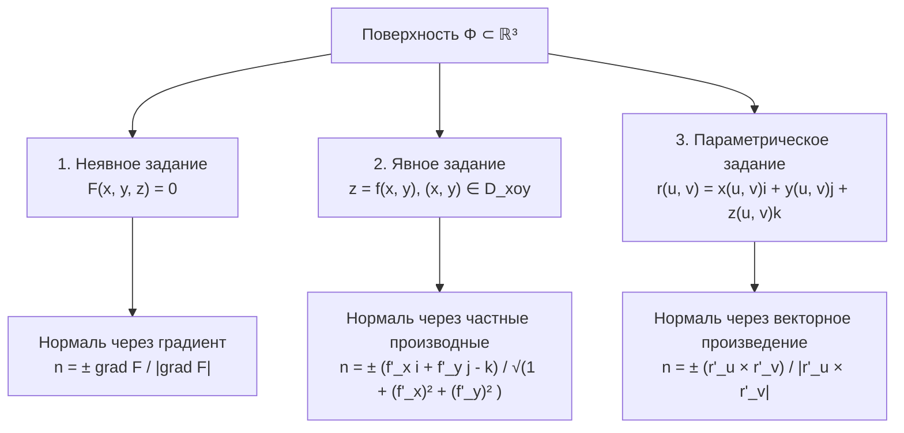
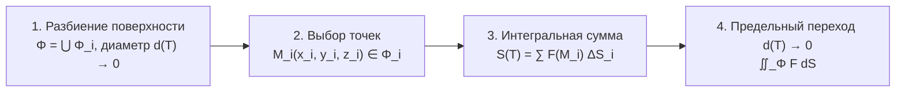

# Лекция 7. Поверхностные интегралы I рода. Гладкие поверхности. Площадь поверхности

**Дата:** 15 октября 2026 г.  
**Дисциплина:** Математический анализ (Кратные интегралы, теория поля, ряды)  
**Модуль 2:** Поверхности и поверхностные интегралы  

---

## 1. Способы задания поверхности в трехмерном пространстве

Пусть в пространстве $\mathbb{R}^3$ с декартовой прямоугольной системой координат $Oxyz$ задана геометрическая поверхность $\Phi$. В математическом анализе различают три основных способа аналитического описания поверхности:

### 1.1. Неявное задание
Поверхность $\Phi$ определяется уравнением:
$$\Phi: F(x, y, z) = 0, \quad (x, y, z) \in \Phi \subset \mathbb{R}^3$$
где $F(x, y, z)$ — непрерывно дифференцируемая функция трёх переменных в области $\Omega \subset \mathbb{R}^3$.

### 1.2. Явное задание
Поверхность представляет собой график однозначной функции двух переменных над замкнутой областью $D_{xoy} \subset \mathbb{R}^2$:
$$\Phi: z = f(x, y), \quad (x, y) \in D_{xoy}$$
(Аналогично поверхность может проектироваться на другие координатные плоскости: $x = f_2(y, z)$ для $(y, z) \in D_{yoz}$ или $y = f_3(x, z)$ для $(x, z) \in D_{xoz}$).

### 1.3. Параметрическое задание
Положение точки на поверхности определяется векторной функцией от двух независимых скалярных параметров $(u, v)$, изменяющихся в области $G \subset \mathbb{R}^2$:
$$\Phi: \begin{cases} 
x = x(u, v) \\ 
y = y(u, v) \\ 
z = z(u, v) 
\end{cases} \quad (u, v) \in G \subset \mathbb{R}^2$$

Радиус-вектор текущей точки поверхности:
$$\vec{r}(u, v) = x(u, v)\vec{i} + y(u, v)\vec{j} + z(u, v)\vec{k}$$

---

## 2. Гладкие поверхности и касательная плоскость

> [!info] Определение (Гладкая поверхность)
> Поверхность $\Phi$ называется **гладкой**, если для любой её внутренней точки существует такая пространственная окрестность, в пределах которой часть поверхности может быть представлена явным уравнением одного из трёх видов:
> $$z = f_1(x, y), \qquad x = f_2(y, z), \qquad y = f_3(x, z)$$
> где соответствующие функции $f_1, f_2, f_3$ являются непрерывно дифференцируемыми (то есть обладают непрерывными частными производными 1-го порядка).

### 2.1. Касательные векторы координатных линий
При параметрическом задании $\vec{r} = \vec{r}(u, v)$ при фиксированном $v = v_0$ вектор-функция $\vec{r}(u, v_0)$ описывает пространственную кривую на поверхности (координатную $u$-линию). Аналогично, при $u = u_0$ кривая $\vec{r}(u_0, v)$ задаёт координатную $v$-линию.

Векторы касательных к этим координатным линиям находятся с помощью частного дифференцирования:
$$\vec{r}'_u = \frac{\partial \vec{r}}{\partial u} = \frac{\partial x}{\partial u}\vec{i} + \frac{\partial y}{\partial u}\vec{j} + \frac{\partial z}{\partial u}\vec{k}$$
$$\vec{r}'_v = \frac{\partial \vec{r}}{\partial v} = \frac{\partial x}{\partial v}\vec{i} + \frac{\partial y}{\partial v}\vec{j} + \frac{\partial z}{\partial v}\vec{k}$$

Эти векторы лежат в **касательной плоскости** к поверхности $\Phi$ в рассматриваемой точке $M$.

---

## 3. Нормаль к поверхности и ориентация (двусторонние поверхности)

Вектор нормали $\vec{n}$ в точке гладкой поверхности ортогонален касательной плоскости, а следовательно, ортогонален обоим касательным векторам $\vec{r}'_u$ и $\vec{r}'_v$:
$$\vec{r}'_u \perp \vec{n}, \qquad \vec{r}'_v \perp \vec{n}$$

### 3.1. Вычисление единичного вектора нормали

1. **Для параметрического задания $\Phi: \vec{r} = \vec{r}(u, v)$:**
   Так как векторное произведение $\vec{r}'_u \times \vec{r}'_v$ перпендикулярно обоим векторам:
   $$\vec{n} = \pm \frac{\vec{r}'_u \times \vec{r}'_v}{|\vec{r}'_u \times \vec{r}'_v|}, \qquad |\vec{n}| = 1$$

2. **Для неявного задания $\Phi: F(x, y, z) = 0$:**
   Градиент $\operatorname{grad} F = F'_x \vec{i} + F'_y \vec{j} + F'_z \vec{k}$ направлен по нормали к поверхности уровня функции:
   $$\vec{n} = \pm \frac{\operatorname{grad} F}{|\operatorname{grad} F|} = \pm \frac{F'_x \vec{i} + F'_y \vec{j} + F'_z \vec{k}}{\sqrt{(F'_x)^2 + (F'_y)^2 + (F'_z)^2}}$$

3. **Для явного задания $\Phi: z = f(x, y)$:**
   Запишем в виде неявной функции $F(x, y, z) = f(x, y) - z = 0$. Тогда:
   $$F'_x = f'_x, \quad F'_y = f'_y, \quad F'_z = -1$$
   $$\vec{n} = \pm \frac{f'_x \vec{i} + f'_y \vec{j} - \vec{k}}{\sqrt{1 + (f'_x)^2 + (f'_y)^2}}$$

> [!info] Определение (Двусторонняя / ориентируемая поверхность)
> Если в каждой точке поверхности $\Phi$ можно выбрать единичный вектор нормали $\vec{n}(M)$ так, чтобы полученное векторное поле $\vec{n}(M)$ было непрерывным на всей поверхности $\Phi$, то такую поверхность называют **двусторонней** (или **ориентируемой**).
> 
> Выбор одного из двух противоположных направлений непрерывного поля нормалей $\vec{n}(M)$ называется **ориентацией поверхности** (выбором стороны поверхности: внешней/внутренней или верхней/нижней).

---

## 4. Площадь гладкой поверхности и первая квадратичная форма Гаусса

Разобьём гладкую двустороннюю поверхность $\Phi$ сетью кривых на $n$ элементарных частей $\Phi_1, \Phi_2, \dots, \Phi_n$. Этому разбиению соответствует разбиение области параметров $G$ на части $G_1, G_2, \dots, G_n$.

Выберем на каждой частичной поверхности $\Phi_i$ точку $M_i$. Проведём через точку $M_i$ касательную плоскость. При достаточно малом диаметре разбиения $d(T) \to 0$ искривлённый участок $\Phi_i$ аппроксимируется плоским четырёхугольником на касательной плоскости, натянутым на векторы приращений $\vec{r}'_u \Delta u$ и $\vec{r}'_v \Delta v$.

Площадь параллелограмма, построенного на векторах приращений, равна модулю их векторного произведения:
$$\Delta S_i \approx |\vec{r}'_u \times \vec{r}'_v| \, \Delta u \, \Delta v$$

### 4.1. Коэффициенты Гаусса первой квадратичной формы
Введём стандартные обозначения дифференциальной геометрии:
$$E = (\vec{r}'_u)^2 = (x'_u)^2 + (y'_u)^2 + (z'_u)^2$$
$$G = (\vec{r}'_v)^2 = (x'_v)^2 + (y'_v)^2 + (z'_v)^2$$
$$F = \vec{r}'_u \cdot \vec{r}'_v = x'_u x'_v + y'_u y'_v + z'_u z'_v$$

Используя тождество Лагранжа для векторного произведения:
$$|\vec{a} \times \vec{b}|^2 = |\vec{a}|^2 |\vec{b}|^2 - (\vec{a} \cdot \vec{b})^2$$
получаем:
$$|\vec{r}'_u \times \vec{r}'_v|^2 = (\vec{r}'_u)^2 (\vec{r}'_v)^2 - (\vec{r}'_u \cdot \vec{r}'_v)^2 = EG - F^2$$
$$|\vec{r}'_u \times \vec{r}'_v| = \sqrt{EG - F^2}$$

### 4.2. Дифференциал площади (элемент площади поверхности)
Элемент площади $dS$ на поверхности выражается через дифференциалы параметров:
$$dS = |\vec{r}'_u \times \vec{r}'_v| \, du \, dv = \sqrt{EG - F^2} \, du \, dv$$

**Полная площадь поверхности $\Phi$:**
$$S_\Phi = \iint_G \sqrt{EG - F^2} \, du \, dv$$

### 4.3. Частный случай явного задания поверхности $z = z(x, y)$
Пусть $u = x, v = y, z = z(x, y)$. Тогда:
$$\vec{r}'_x = \{1, 0, z'_x\}, \qquad \vec{r}'_y = \{0, 1, z'_y\}$$
$$E = (\vec{r}'_x)^2 = 1 + (z'_x)^2$$
$$G = (\vec{r}'_y)^2 = 1 + (z'_y)^2$$
$$F = \vec{r}'_x \cdot \vec{r}'_y = z'_x z'_y$$

Вычислим подкоренное выражение:
$$EG - F^2 = (1 + (z'_x)^2)(1 + (z'_y)^2) - (z'_x z'_y)^2 = 1 + (z'_x)^2 + (z'_y)^2 + (z'_x)^2(z'_y)^2 - (z'_x)^2(z'_y)^2 = 1 + (z'_x)^2 + (z'_y)^2$$

Следовательно:
$$dS = \sqrt{1 + (z'_x)^2 + (z'_y)^2} \, dx \, dy$$
$$S_\Phi = \iint_{D_{xoy}} \sqrt{1 + (z'_x)^2 + (z'_y)^2} \, dx \, dy$$

### 4.4. Пример: Элемент площади сферы радиуса $a$
В сферических координатах параметрические уравнения сферы радиуса $a$ имеют вид:
$$\begin{cases}
x = a \cos\theta \cos\varphi \\
y = a \cos\theta \sin\varphi \\
z = a \sin\theta
\end{cases} \quad \varphi \in [0, 2\pi], \quad \theta \in \left[-\frac{\pi}{2}, \frac{\pi}{2}\right]$$

Параметры: $u = \varphi, v = \theta$.
Частные производные:
$$\vec{r}'_\varphi = \{-a \cos\theta \sin\varphi, \, a \cos\theta \cos\varphi, \, 0\}$$
$$\vec{r}'_\theta = \{-a \sin\theta \cos\varphi, \, -a \sin\theta \sin\varphi, \, a \cos\theta\}$$

Вычисляем квадратичные коэффициенты:
$$E = (\vec{r}'_\varphi)^2 = a^2 \cos^2\theta \sin^2\varphi + a^2 \cos^2\theta \cos^2\varphi = a^2 \cos^2\theta$$
$$G = (\vec{r}'_\theta)^2 = a^2 \sin^2\theta (\cos^2\varphi + \sin^2\varphi) + a^2 \cos^2\theta = a^2 (\sin^2\theta + \cos^2\theta) = a^2$$
$$F = \vec{r}'_\varphi \cdot \vec{r}'_\theta = a^2 \sin\theta \cos\theta \sin\varphi \cos\varphi - a^2 \sin\theta \cos\theta \sin\varphi \cos\varphi + 0 = 0$$

Тогда:
$$EG - F^2 = a^2 \cos^2\theta \cdot a^2 - 0 = a^4 \cos^2\theta$$
$$\sqrt{EG - F^2} = a^2 \cos\theta \quad \left(\text{так как } \cos\theta \ge 0 \text{ при } \theta \in [-\pi/2, \pi/2]\right)$$

Дифференциал площади сферы:
$$dS = a^2 \cos\theta \, d\varphi \, d\theta$$

---

## 5. Поверхностный интеграл I рода (по площади поверхности)

### 5.1. Конструкция интегральной суммы
Пусть на гладкой поверхности $\Phi$, ограниченной кусочно-гладким контуром $L$, определена ограниченная скалярная функция $F(M) = F(x, y, z)$.

1. Разобьём поверхность $\Phi$ на $n$ элементарных частей:
   $$T = \{\Phi_1, \Phi_2, \dots, \Phi_n\}$$
   Обозначим через $d_i$ диаметр частицы $\Phi_i$ (наибольшее расстояние между точками $\Phi_i$), а через $\Delta S_i$ — её площадь.  
   **Диаметр разбиения:**
   $$d(T) = \max_{1 \le i \le n} d_i$$

2. Внутри каждой части $\Phi_i$ выберем произвольную промежуточную точку:
   $$M_i(x_i, y_i, z_i) \in \Phi_i$$

3. Составим интегральную сумму:
   $$S(T) = \sum_{i=1}^n F(M_i) \, \Delta S_i = \sum_{i=1}^n F(x_i, y_i, z_i) \, \Delta S_i$$

### 5.2. Определение поверхностного интеграла I рода

> [!info] Определение
> Если при стремлении диаметра разбиения $d(T) \to 0$ существует конечный предел интегральной суммы $S(T)$, не зависящий ни от способа разбиения $T$ поверхности $\Phi$, ни от выбора промежуточных точек $M_i$, то этот предел называется **поверхностным интегралом первого рода** (или интегралом по площади поверхности) от функции $F(x, y, z)$ по поверхности $\Phi$ и обозначается:
> $$\iint_\Phi F(x, y, z) \, dS = \lim_{d(T) \to 0} \sum_{i=1}^n F(x_i, y_i, z_i) \, \Delta S_i$$

### 5.3. Теорема о существовании и сведении к двойному интегралу

> [!info] Теорема (Вычисление интеграла I рода)
> Если поверхность $\Phi$ гладкая и двусторонняя, а функция $F(x, y, z)$ непрерывна во всех точках $\Phi$, то поверхностный интеграл I рода $\iint_\Phi F(x, y, z) dS$ существует.

**Формулы перехода к обычному двойному интегралу:**

1. **При параметрическом задании** $\Phi: \vec{r} = \vec{r}(u, v), (u, v) \in G$:
   $$\iint_\Phi F(x, y, z) \, dS = \iint_G F(x(u, v), y(u, v), z(u, v)) \sqrt{EG - F^2} \, du \, dv$$

2. **При явном задании** $\Phi: z = z(x, y), (x, y) \in D_{xoy}$:
   $$\iint_\Phi F(x, y, z) \, dS = \iint_{D_{xoy}} F(x, y, z(x, y)) \sqrt{1 + (z'_x)^2 + (z'_y)^2} \, dx \, dy$$

3. **Для сферы радиуса $a$** в сферических координатах:
   $$\iint_\Phi F(x, y, z) \, dS = \int_0^{2\pi} d\varphi \int_{-\pi/2}^{\pi/2} F(a\cos\theta\cos\varphi, a\cos\theta\sin\varphi, a\sin\theta) \cdot a^2 \cos\theta \, d\theta$$

---

## 6. Практический пример: вычисление поверхностного интеграла

> [!example] Задача из лекции
> Вычислить поверхностный интеграл I рода:
> $$I = \iint_\Phi \sqrt{z^2 - y^2} \, dS$$
> где поверхность $\Phi$ представляет собой часть конической поверхности $x^2 + y^2 = z^2$, вырезаемую цилиндром $x^2 + y^2 \le a^2$ ($a > 0$).

### Решение:

1. **Геометрический анализ поверхности:**
   Уравнение $x^2 + y^2 = z^2$ описывает полный круговой конус с вершиной в начале координат. Плоскости $z = \pm a$ ограничивают две симметричные полости:
   - Верхняя полость: $\Phi_1: z = +\sqrt{x^2 + y^2}$
   - Нижняя полость: $\Phi_2: z = -\sqrt{x^2 + y^2}$

   Проекцией обеих полостей на плоскость $Oxy$ является один и тот же круг:
   $$D_{xoy}: x^2 + y^2 \le a^2$$

   По свойству аддитивности поверхностного интеграла:
   $$I = \iint_{\Phi_1} \sqrt{z^2 - y^2} \, dS + \iint_{\Phi_2} \sqrt{z^2 - y^2} \, dS$$

2. **Вычисление дифференциала площади $dS$:**
   Для верхней части $\Phi_1$: $z = \sqrt{x^2 + y^2}$.
   Частные производные:
   $$z'_x = \frac{x}{\sqrt{x^2 + y^2}}, \qquad z'_y = \frac{y}{\sqrt{x^2 + y^2}}$$
   Тогда:
   $$(z'_x)^2 + (z'_y)^2 = \frac{x^2}{x^2 + y^2} + \frac{y^2}{x^2 + y^2} = \frac{x^2 + y^2}{x^2 + y^2} = 1$$
   Элемент площади:
   $$dS = \sqrt{1 + (z'_x)^2 + (z'_y)^2} \, dx \, dy = \sqrt{1 + 1} \, dx \, dy = \sqrt{2} \, dx \, dy$$

   Для нижней части $\Phi_2$: $z = -\sqrt{x^2 + y^2}$.
   Производные $z'_x = \frac{-x}{\sqrt{x^2 + y^2}}$ и $z'_y = \frac{-y}{\sqrt{x^2 + y^2}}$, их квадраты те же, поэтому $dS = \sqrt{2} \, dx \, dy$.

3. **Подстановка подынтегральной функции:**
   Поскольку на поверхности конуса выполнено $z^2 = x^2 + y^2$, получаем:
   $$\sqrt{z^2 - y^2} = \sqrt{(x^2 + y^2) - y^2} = \sqrt{x^2} = |x|$$

   Заметим, что подынтегральное выражение одинаково и неотрицательно на обеих полостях конуса.

4. **Сведение к двойному интегралу:**
   $$I = \iint_{D_{xoy}} |x| \sqrt{2} \, dx \, dy + \iint_{D_{xoy}} |x| \sqrt{2} \, dx \, dy = 2\sqrt{2} \iint_{D_{xoy}} |x| \, dx \, dy$$

5. **Переход в полярные координаты:**
   $$x = r\cos\varphi, \quad y = r\sin\varphi, \quad dx \, dy = r \, dr \, d\varphi$$
   Область $D_{xoy}$: $r \in [0, a]$, $\varphi \in [0, 2\pi]$.

   $$I = 2\sqrt{2} \int_0^{2\pi} |\cos\varphi| \, d\varphi \int_0^a r^2 \, dr$$

   Интеграл по радиусу:
   $$\int_0^a r^2 \, dr = \left[ \frac{r^3}{3} \right]_0^a = \frac{a^3}{3}$$

   Интеграл по углу (в силу периодичности и симметрии $|\cos\varphi|$ по 4 четвертям):
   $$\int_0^{2\pi} |\cos\varphi| \, d\varphi = 4 \int_0^{\pi/2} \cos\varphi \, d\varphi = 4 \Big[ \sin\varphi \Big]_0^{\pi/2} = 4(1 - 0) = 4$$

6. **Итоговый результат:**
   $$I = 2\sqrt{2} \cdot 4 \cdot \frac{a^3}{3} = \frac{8\sqrt{2}}{3} a^3$$

> [!tip] Ответ
> $$\iint_\Phi \sqrt{z^2 - y^2} \, dS = \frac{8\sqrt{2}}{3} a^3$$
