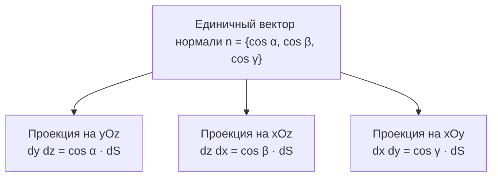
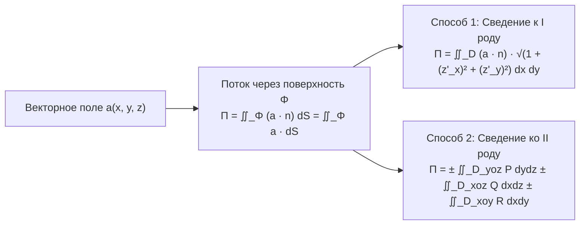
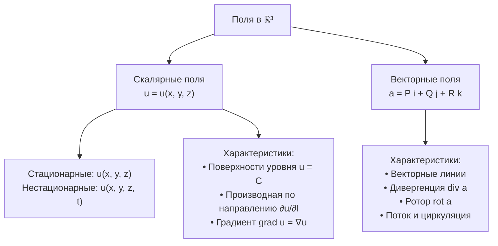

# Лекция 8. Поверхностные интегралы II рода. Поток векторного поля. Скалярные поля

**Дата:** 22 октября 2026 г.  
**Дисциплина:** Математический анализ (Кратные интегралы, теория поля, ряды)  
**Модуль 2:** Поверхностные интегралы и теория поля  

---

## 1. Свойства поверхностных интегралов I рода

Напомним основные свойства поверхностного интеграла первого рода $\iint_\Phi f(M) \, dS$, где $\Phi \subset \mathbb{R}^3$ — гладкая двусторонняя поверхность:

1. **Геометрический смысл (площадь поверхности):**
   $$\iint_\Phi dS = S_\Phi$$
   где $S_\Phi$ — площадь поверхности $\Phi$.

2. **Линейность:**
   Если функции $f(M)$ и $g(M)$ интегрируемы на поверхности $\Phi$, то для любых постоянных $\alpha, \beta \in \mathbb{R}$ функция $\alpha f(M) + \beta g(M)$ также интегрируема, и:
   $$\iint_\Phi \big(\alpha f(M) + \beta g(M)\big) \, dS = \alpha \iint_\Phi f(M) \, dS + \beta \iint_\Phi g(M) \, dS$$

3. **Аддитивность по поверхности:**
   Если поверхность $\Phi$ состоит из двух частей $\Phi_1$ и $\Phi_2$ ($\Phi = \Phi_1 \cup \Phi_2$), не имеющих общих внутренних точек (пересекающихся максимум по кусочно-гладкой границе), то:
   $$\iint_\Phi f(M) \, dS = \iint_{\Phi_1} f(M) \, dS + \iint_{\Phi_2} f(M) \, dS$$

4. **Независимость от ориентации (стороны поверхности):**
   Значение поверхностного интеграла I рода не зависит от выбора стороны (направления вектора нормали) поверхности:
   $$\iint_{\Phi^+} f(M) \, dS = \iint_{\Phi^-} f(M) \, dS$$

5. **Монотонность и сохранение знака:**
   - Если во всех точках $M \in \Phi$ выполнено $f(M) \ge 0$, то:
     $$\iint_\Phi f(M) \, dS \ge 0$$
   - Если $f(M) \le g(M)$ для всех $M \in \Phi$, то $\iint_\Phi f(M) \, dS \le \iint_\Phi g(M) \, dS$.

6. **Теорема о среднем значении:**
   Если функция $f(M)$ непрерывна на связной гладкой поверхности $\Phi$ площадью $S_\Phi$, то на поверхности существует хотя бы одна точка $M_0 \in \Phi$ такая, что:
   $$\iint_\Phi f(M) \, dS = f(M_0) \cdot S_\Phi$$

---

## 2. Поверхностные интегралы II рода (по координатам)

### 2.1. Ориентация поверхности и единичная нормаль
Пусть $\Phi$ — гладкая двусторонняя поверхность. Выбор определённой стороны поверхности задаётся непрерывным полем единичных нормалей:
$$\vec{n} = \{\cos\alpha, \cos\beta, \cos\gamma\}, \qquad |\vec{n}| = \sqrt{\cos^2\alpha + \cos^2\beta + \cos^2\gamma} = 1$$
где направляющие косинусы определяются углами между вектором нормали $\vec{n}$ и положительными направлениями координатных осей:
$$\alpha = \angle(\vec{n}, Ox), \quad \beta = \angle(\vec{n}, Oy), \quad \gamma = \angle(\vec{n}, Oz)$$

### 2.2. Связь элемента площади с координатными дифференциалами
Рассмотрим элементарную площадку $dS$ на касательной плоскости к поверхности в точке $M$. Её ортогональные проекции на координатные плоскости равны:
- На плоскость $Oyz$: $dy \, dz = \cos\alpha \, dS$
- На плоскость $Oxz$: $dz \, dx = \cos\beta \, dS$
- На плоскость $Oxy$: $dx \, dy = \cos\gamma \, dS$

> [!note] Правило знаков ориентированной проекции
> При проектировании на плоскость (например, $Oxy$) знак проекции определяется углом $\gamma$ между вектором нормали $\vec{n}$ и осью $Oz$:
> - Если $\gamma$ — острый угол ($\cos\gamma > 0$, нормаль направлена «вверх»), берётся знак **«$+$»**.
> - Если $\gamma$ — тупой угол ($\cos\gamma < 0$, нормаль направлена «вниз»), берётся знак **«$-$»**.
> - Если $\gamma = \frac{\pi}{2}$ ($\cos\gamma = 0$, нормаль параллельна плоскости $Oxy$), проекция вырождается в линию, её площадь равна 0.

### 2.3. Определение поверхностного интеграла II рода
Пусть на ориентированной поверхности $\Phi$ определены три непрерывные функции $P(x, y, z)$, $Q(x, y, z)$ и $R(x, y, z)$.

> [!info] Определение
> **Поверхностным интегралом второго рода** (или интегралом по координатам) по ориентированной поверхности $\Phi$ называется поверхностный интеграл первого рода от линейной комбинации с направляющими косинусами нормали:
> $$\iint_\Phi P \, dy \, dz + Q \, dz \, dx + R \, dx \, dy \stackrel{\text{def}}{=} \iint_\Phi \big(P(x, y, z)\cos\alpha + Q(x, y, z)\cos\beta + R(x, y, z)\cos\gamma\big) \, dS$$

---

## 3. Свойства поверхностных интегралов II рода

1. **Зависимость от ориентации (стороны поверхности):**
   При смене стороны поверхности на противоположную нормаль меняет знак: $\vec{n}^* = -\vec{n}$, направляющие косинусы меняют знаки $\cos\alpha^* = -\cos\alpha, \dots$, поэтому поверхностный интеграл второго рода **меняет знак на противоположный**:
   $$\iint_{\Phi^-} P \, dy \, dz + Q \, dz \, dx + R \, dx \, dy = -\iint_{\Phi^+} P \, dy \, dz + Q \, dz \, dx + R \, dx \, dy$$

2. **Линейность:**
   $$\iint_\Phi (\alpha P_1 + \beta P_2) \, dy \, dz + \dots = \alpha \iint_\Phi P_1 \, dy \, dz + \dots + \beta \iint_\Phi P_2 \, dy \, dz + \dots$$

3. **Аддитивность по поверхности:**
   Если $\Phi = \Phi_1 \cup \Phi_2$, где части имеют одинаковую ориентацию и не перекрываются во внутренних точках:
   $$\iint_\Phi = \iint_{\Phi_1} + \iint_{\Phi_2}$$

4. **Обращение в ноль для цилиндрических поверхностей:**
   Если поверхность $\Phi$ является цилиндрической с образующими, параллельными оси $Oz$, то в любой точке нормаль ортогональна оси $Oz$ ($\cos\gamma = 0$). Проекция такой поверхности на плоскость $Oxy$ вырождается в кривую нулевой площади:
   $$\iint_\Phi R(x, y, z) \, dx \, dy = 0$$
   Аналогично:
   - Если образующие $\parallel Ox \implies \iint_\Phi P(x, y, z) \, dy \, dz = 0$
   - Если образующие $\parallel Oy \implies \iint_\Phi Q(x, y, z) \, dz \, dx = 0$

---

## 4. Поток векторного поля (физический смысл интеграла II рода)

Пусть в пространстве задано стационарное векторное поле скоростей течения несжимаемой жидкости:
$$\vec{a}(M) = a_x(x, y, z)\vec{i} + a_y(x, y, z)\vec{j} + a_z(x, y, z)\vec{k} = P\vec{i} + Q\vec{j} + R\vec{k}$$

Через элементарную площадку $dS$ с нормалью $\vec{n}$ за единицу времени протекает объём жидкости:
$$d\Pi = (\vec{a} \cdot \vec{n}) \, dS = \vec{a} \cdot d\vec{S}$$
где $d\vec{S} = \vec{n} \, dS$ — векторный элемент поверхности.

> [!info] Определение (Поток векторного поля)
> **Потоком векторного поля $\vec{a}$** через ориентированную поверхность $\Phi$ в направлении нормали $\vec{n}$ называется интеграл:
> $$\Pi = \iint_\Phi (\vec{a} \cdot \vec{n}) \, dS = \iint_\Phi P \, dy \, dz + Q \, dz \, dx + R \, dx \, dy$$

---

## 5. Вычисление поверхностного интеграла II рода

Существует два основных способа вычисления:

### Способ 1. Сведение к поверхностному интегралу I рода
Для явно заданной поверхности $\Phi: z = z(x, y)$ единичный вектор нормали:
$$\vec{n} = \pm \frac{-z'_x \vec{i} - z'_y \vec{j} + \vec{k}}{\sqrt{1 + (z'_x)^2 + (z'_y)^2}}$$
Элемент площади:
$$dS = \sqrt{1 + (z'_x)^2 + (z'_y)^2} \, dx \, dy$$

При вычислении скалярного произведения $\vec{a} \cdot \vec{n} \, dS$ радикалы в знаменателе нормали и в числителе $dS$ **взаимно сокращаются**:
$$\Pi = \iint_{D_{xoy}} \pm \big(-P \cdot z'_x - Q \cdot z'_y + R\big) \, dx \, dy$$
Знак «$+$» или «$-$» выбирается в соответствии с ориентацией (направлением вектора нормали).

### Способ 2. Проектирование на три координатные плоскости
Интеграл вычисляется как сумма трёх обычных двойных интегралов по проекциям поверхности на координатные плоскости:
$$\iint_\Phi P \, dy \, dz + Q \, dz \, dx + R \, dx \, dy = \pm \iint_{D_{yoz}} P(x(y, z), y, z) \, dy \, dz \pm \iint_{D_{xoz}} Q(x, y(x, z), z) \, dz \, dx \pm \iint_{D_{xoy}} R(x, y, z(x, y)) \, dx \, dy$$
Перед каждым двойным интегралом знак выбирается по знаку соответствующего направляющего косинуса ($\cos\alpha$, $\cos\beta$, $\cos\gamma$).

---

## 6. Подробный разбор практической задачи

> [!example] Задача из лекции
> Найти поток векторного поля:
> $$\vec{a} = 2x\vec{i} + y^2\vec{j} + z^2\vec{k}$$
> через часть поверхности параболоида:
> $$\Phi: z = \frac{H}{R^2}(x^2 + y^2), \qquad z \le H \quad (H > 0, R > 0)$$
> в направлении **внутренней нормали**.

### Геометрический анализ
- Поверхность $\Phi$ — круговой параболоид с вершиной в начале координат $(0, 0, 0)$, направленный ветвями вверх и ограниченный сверху плоскостью $z = H$.
- Проекция поверхности на плоскость $Oxy$ — круг радиуса $R$:
  $$D_{xoy}: x^2 + y^2 \le R^2$$
- Внутренняя нормаль направлена внутрь «чаши» параболоида (к оси $Oz$ и вверх). Следовательно, её третья координата положительна ($\cos\gamma > 0$).

---

### Метод 1: Сведение к интегралу I рода

1. **Единичный вектор внутренней нормали:**
   Уравнение поверхности: $z = \frac{H}{R^2}(x^2+y^2)$.  
   Частные производные:
   $$z'_x = \frac{2Hx}{R^2}, \qquad z'_y = \frac{2Hy}{R^2}$$
   Внутренняя нормаль направлена вверх, значит коэффициент перед $\vec{k}$ должен быть положительным:
   $$\vec{n} = \frac{-z'_x \vec{i} - z'_y \vec{j} + \vec{k}}{\sqrt{1 + (z'_x)^2 + (z'_y)^2}} = \frac{-\frac{2Hx}{R^2}\vec{i} - \frac{2Hy}{R^2}\vec{j} + \vec{k}}{\sqrt{1 + \frac{4H^2}{R^4}(x^2+y^2)}}$$

2. **Скалярное произведение $\vec{a} \cdot \vec{n}$:**
   $$\vec{a} \cdot \vec{n} = \frac{(2x)\left(-\frac{2Hx}{R^2}\right) + (y^2)\left(-\frac{2Hy}{R^2}\right) + (z^2)(1)}{\sqrt{1 + \frac{4H^2}{R^4}(x^2+y^2)}} = \frac{-\frac{4Hx^2}{R^2} - \frac{2Hy^3}{R^2} + z^2}{\sqrt{1 + \frac{4H^2}{R^4}(x^2+y^2)}}$$

3. **Сокращение со знаменателем дифференциала $dS$:**
   $$dS = \sqrt{1 + \frac{4H^2}{R^4}(x^2+y^2)} \, dx \, dy$$
   $$(\vec{a} \cdot \vec{n}) \, dS = \left(-\frac{4H}{R^2}x^2 - \frac{2H}{R^2}y^3 + z^2\right) dx \, dy$$

4. **Подстановка $z = \frac{H}{R^2}(x^2+y^2)$:**
   $$z^2 = \frac{H^2}{R^4}(x^2+y^2)^2$$
   $$\Pi = \iint_{D_{xoy}} \left( -\frac{4H}{R^2}x^2 - \frac{2H}{R^2}y^3 + \frac{H^2}{R^4}(x^2+y^2)^2 \right) dx \, dy$$

5. **Вычисление интегралов по кругу $D_{xoy}$:**
   - По симметрии области $D_{xoy}$ относительно оси $Ox$, нечётная функция $y^3$ даёт ноль:
     $$\iint_{D_{xoy}} y^3 \, dx \, dy = 0$$
   - Для первого слагаемого перейдём к полярным координатам ($x = r\cos\varphi, dx dy = r dr d\varphi$):
     $$\iint_{D_{xoy}} x^2 \, dx \, dy = \int_0^{2\pi} \cos^2\varphi \, d\varphi \int_0^R r^3 \, dr = \pi \cdot \frac{R^4}{4}$$
     Первое слагаемое:
     $$-\frac{4H}{R^2} \cdot \frac{\pi R^4}{4} = -\pi H R^2$$
   - Для третьего слагаемого:
     $$\iint_{D_{xoy}} (x^2+y^2)^2 \, dx \, dy = \int_0^{2\pi} d\varphi \int_0^R r^5 \, dr = 2\pi \cdot \frac{R^6}{6} = \frac{\pi R^6}{3}$$
     Третье слагаемое:
     $$\frac{H^2}{R^4} \cdot \frac{\pi R^6}{3} = \frac{\pi H^2 R^2}{3}$$

6. **Итоговый результат потока:**
   $$\Pi = -\pi H R^2 + \frac{\pi H^2 R^2}{3} = \pi H R^2 \left( \frac{H}{3} - 1 \right)$$

---

### Метод 2: Проектирование на координатные плоскости

Поток представляется суммой трёх поверхностных интегралов II рода:
$$\Pi = \iint_\Phi 2x \, dy \, dz + \iint_\Phi y^2 \, dz \, dx + \iint_\Phi z^2 \, dx \, dy = I_1 + I_2 + I_3$$

1. **Интеграл $I_1 = \iint_\Phi 2x \, dy \, dz$ (проекция на плоскость $Oyz$):**
   - Уравнение поверхности: $x = \pm \sqrt{\frac{R^2}{H}z - y^2}$.
   - Область $D_{yoz}$ ограничена параболой $z = \frac{H}{R^2}y^2$ и прямой $z = H$, где $y \in [-R, R]$.
   - Поверхность разбивается плоскостью $x = 0$ на две полуповерхности:
     - Для $x \ge 0$: внутренняя нормаль направлена влево (к отрицательным значениям $x$), поэтому угол $\alpha$ тупой ($\cos\alpha < 0 \implies$ знак «$-»$):
       $$- \iint_{D_{yoz}} 2\sqrt{\frac{R^2}{H}z - y^2} \, dy \, dz$$
     - Для $x \le 0$: внутренняя нормаль направлена вправо (к положительным $x$), угол $\alpha$ острый ($\cos\alpha > 0 \implies$ знак «$+»$):
       $$+ \iint_{D_{yoz}} 2\left(-\sqrt{\frac{R^2}{H}z - y^2}\right) \, dy \, dz$$
   - Суммируя обе части:
     $$I_1 = -4 \iint_{D_{yoz}} \sqrt{\frac{R^2}{H}z - y^2} \, dy \, dz = -\pi H R^2$$

2. **Интеграл $I_2 = \iint_\Phi y^2 \, dz \, dx$ (проекция на плоскость $Oxz$):**
   - Поверхность выражается как $y = \pm \sqrt{\frac{R^2}{H}z - x^2}$.
   - Подынтегральная функция $y^2 = \frac{R^2}{H}z - x^2$ одинакова на обеих половинах ($y \ge 0$ и $y \le 0$).
   - Однако нормаль на части $y \ge 0$ образует тупой угол с осью $Oy$ (знак «$-»$), а на части $y \le 0$ — острый угол (знак «$+»$):
     $$I_2 = -\iint_{D_{xoz}} \left(\frac{R^2}{H}z - x^2\right) dx \, dz + \iint_{D_{xoz}} \left(\frac{R^2}{H}z - x^2\right) dx \, dz = 0$$
   - Интегралы взаимно уничтожаются!

3. **Интеграл $I_3 = \iint_\Phi z^2 \, dx \, dy$ (проекция на плоскость $Oxy$):**
   - Во всех точках внутренней стороны параболоида нормаль образует острый угол с осью $Oz$ ($\cos\gamma > 0 \implies$ знак «$+»$):
     $$I_3 = +\iint_{D_{xoy}} z^2(x, y) \, dx \, dy = \iint_{D_{xoy}} \frac{H^2}{R^4}(x^2+y^2)^2 \, dx \, dy = \frac{\pi H^2 R^2}{3}$$

4. **Полный поток:**
   $$\Pi = I_1 + I_2 + I_3 = -\pi H R^2 + 0 + \frac{\pi H^2 R^2}{3} = \pi H R^2 \left( \frac{H}{3} - 1 \right)$$

Оба метода приводят к абсолютно идентичному результату.

---

## 7. Введение в теорию поля: скалярные поля

### 7.1. Понятие поля в математике и физике

> [!info] Определение (Поле)
> Если каждой точке $M$ некоторой пространственной области $\Omega \subset \mathbb{R}^3$ поставлено в соответствие значение определённой физической или математической величины, то говорят, что в области $\Omega$ задано **поле**.

- **Скалярное поле:** каждой точке $M$ ставится в соответствие число (скаляр):
  $$u = u(M) = u(x, y, z)$$
  *Примеры:* поле температур $T(x, y, z)$, поле давлений $p(x, y, z)$, поле электрического потенциала $\varphi(x, y, z)$, поле плотности $\rho(x, y, z)$.
- **Векторное поле:** каждой точке $M$ ставится в соответствие вектор:
  $$\vec{a} = \vec{a}(M) = a_x(x, y, z)\vec{i} + a_y(x, y, z)\vec{j} + a_z(x, y, z)\vec{k}$$
  *Примеры:* поле скоростей частиц жидкости $\vec{v}(M)$, силовые поля (гравитационное поле, электростатическое поле $\vec{E}$, магнитное поле $\vec{B}$).

### 7.2. Классификация скалярных полей
1. **Стационарные и нестационарные:**
   - *Стационарное:* значения в точках не меняются с течением времени $u = u(x, y, z)$.
   - *Нестационарное:* значения явно зависят от времени $t$: $u = u(x, y, z, t)$.
2. **Однородное поле:** поле, принимающее во всех точках области одно и то же постоянное значение ($u(M) \equiv \text{const}$).
3. **Плоское поле:** поле, значение которого зависит только от двух координат (например, $u = u(x, y)$).

### 7.3. Геометрические характеристики скалярного поля

1. **Поверхности уровня:**
   Множество точек пространства, в которых скалярное поле принимает постоянное значение:
   $$u(x, y, z) = C, \qquad C = \text{const}$$
   Через каждую точку области $\Omega$, где $\operatorname{grad} u \ne 0$, проходит ровно одна поверхность уровня.
2. **Линии уровня:**
   Для плоского поля $u(x, y)$ множества точек постоянного значения образуют линии на плоскости:
   $$u(x, y) = C$$

### 7.4. Градиент скалярного поля и оператор Гамильтона (набла)

> [!info] Определение (Градиент)
> **Градиентом** дифференцируемого скалярного поля $u(x, y, z)$ называется вектор, координатами которого являются частные производные поля:
> $$\operatorname{grad} u = \frac{\partial u}{\partial x}\vec{i} + \frac{\partial u}{\partial y}\vec{j} + \frac{\partial u}{\partial z}\vec{k}$$

С помощью **символического дифференциального оператора Гамильтона (набла $\nabla$)**:
$$\nabla = \vec{i}\frac{\partial}{\partial x} + \vec{j}\frac{\partial}{\partial y} + \vec{k}\frac{\partial}{\partial z}$$
градиент записывается компактно:
$$\operatorname{grad} u = \nabla u$$

### 7.5. Производная по направлению

Пусть задано направление единичным вектором:
$$\vec{l}_0 = \{\cos\alpha, \cos\beta, \cos\gamma\}, \qquad |\vec{l}_0| = 1$$

> [!info] Определение (Производная по направлению)
> Производная скалярного поля $u$ в направлении $\vec{l}$ характеризует скорость изменения поля в данном направлении и вычисляется через скалярное произведение:
> $$\frac{\partial u}{\partial l} = \operatorname{grad} u \cdot \vec{l}_0 = \frac{\partial u}{\partial x}\cos\alpha + \frac{\partial u}{\partial y}\cos\beta + \frac{\partial u}{\partial z}\cos\gamma$$

### 7.6. Основные свойства градиента
1. **Геометрический смысл:**
   Градиент $\operatorname{grad} u(M)$ в точке $M$ всегда **перпендикулярен поверхности уровня** $u(x, y, z) = C$, проходящей через эту точку:
   $$\operatorname{grad} u \perp \text{касательной плоскости к } u(x, y, z) = C$$
2. **Направление наибольшего роста:**
   Так как $\frac{\partial u}{\partial l} = |\operatorname{grad} u| \cos\theta$, где $\theta = \angle(\operatorname{grad} u, \vec{l}_0)$, то:
   - Максимальная скорость роста достигается при $\theta = 0$ (когда $\vec{l}_0 \uparrow\uparrow \operatorname{grad} u$):
     $$\left( \frac{\partial u}{\partial l} \right)_{\max} = |\operatorname{grad} u|$$
   - Градиент указывает **направление наискорейшего возрастания** скалярного поля, а его модуль равен максимальной скорости этого возрастания.
3. **Линейность:**
   $$\operatorname{grad}(\alpha u + \beta v) = \alpha \operatorname{grad} u + \beta \operatorname{grad} v$$
4. **Правило Лейбница для произведения:**
   $$\operatorname{grad}(u \cdot v) = u \operatorname{grad} v + v \operatorname{grad} u$$
5. **Дифференцирование дроби:**
   $$\operatorname{grad}\left(\frac{u}{v}\right) = \frac{v \operatorname{grad} u - u \operatorname{grad} v}{v^2} \quad (v \ne 0)$$
