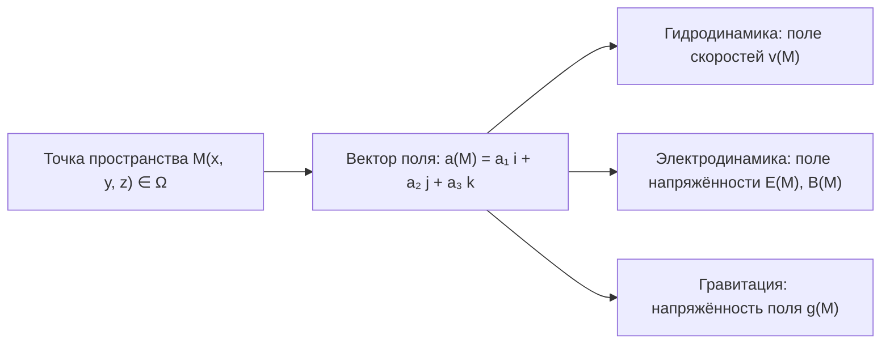
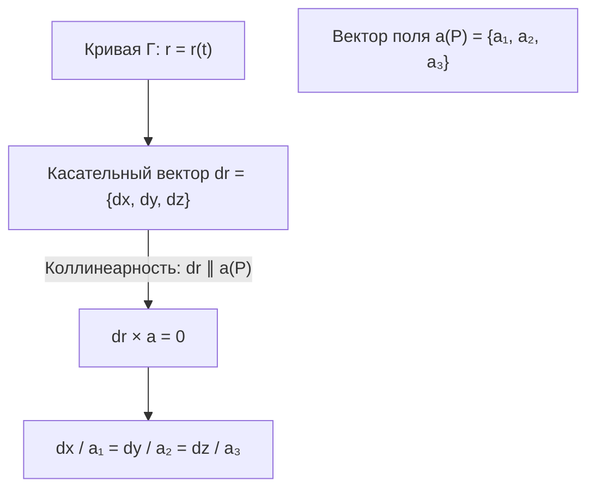
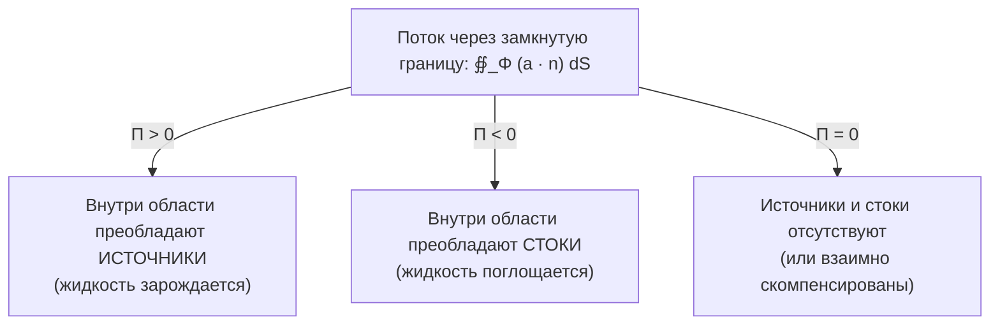
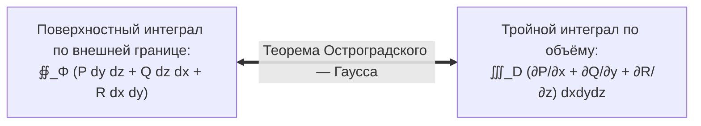
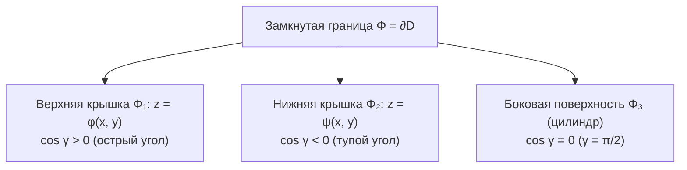
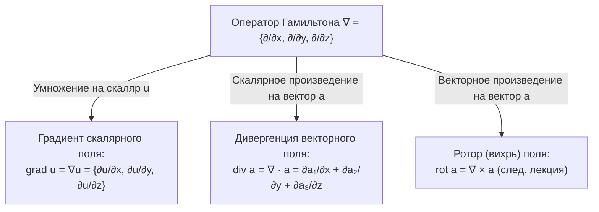
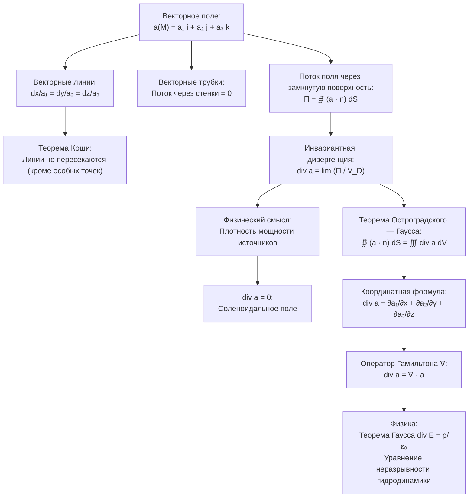

# Лекция 9. Теория поля: векторные поля, векторные линии, дивергенция. Формула Остроградского — Гаусса

**Дата:** 29 октября 2026 г.  
**Дисциплина:** Математический анализ (Кратные интегралы, теория поля, ряды)  
**Модуль 2:** Поверхностные интегралы и теория поля  

---

## 1. Векторные поля в пространстве

### 1.1. Определение векторного поля
Пусть $\Omega$ — некоторая область в трёхмерном евклидовом пространстве $\mathbb{R}^3$.

> [!important] Определение векторного поля
> Говорят, что в области $\Omega$ задано **векторное поле**, если каждой точке $M(x, y, z) \in \Omega$ поставлен в соответствие определённый вектор:
> $$\vec{a}(M) = \vec{a}(x, y, z) = a_1(x, y, z)\vec{i} + a_2(x, y, z)\vec{j} + a_3(x, y, z)\vec{k}$$
> Функции $a_1(x, y, z)$, $a_2(x, y, z)$, $a_3(x, y, z)$ (в координатной форме также обозначаемые $P(x, y, z)$, $Q(x, y, z)$, $R(x, y, z)$) называются **координатными функциями** векторного поля.

### 1.2. Классификация векторных полей
1. **По зависимости от времени:**
   - **Стационарные поля:** вектор поля не зависит от времени $t$ явно, а зависит только от пространственных координат точки:
     $$\vec{a} = \vec{a}(x, y, z), \qquad \frac{\partial \vec{a}}{\partial t} = \vec{0}$$
   - **Нестационарные поля:** характеристики поля меняются во времени: $\vec{a} = \vec{a}(x, y, z, t)$.
2. **По пространственной однородности:**
   - **Однородные поля:** вектор поля во всех точках области постоянен по модулю и направлению ($\vec{a}(M) \equiv \vec{\mathrm{const}}$).
   - **Неоднородные поля:** вектор поля изменяется от точки к точке.
3. **По размерности зависимости:**
   - **Пространственные (трехмерные):** координатные функции зависят от трех переменных $x, y, z$.
   - **Плоские поля:** поле параллельно некоторой плоскости (например, $Oxy$), а его компоненты не зависят от координаты $z$:
     $$\vec{a}(x, y) = a_1(x, y)\vec{i} + a_2(x, y)\vec{j}, \qquad a_3 \equiv 0$$
   - **Одномерные (линейные) поля:** поле зависит только от одной пространственной координаты: $\vec{a} = a_1(x)\vec{i}$.

---

## 2. Векторные линии (силовые линии, линии тока)

### 2.1. Определение векторной линии
Для наглядного геометрического представления векторных полей вводят понятие векторных линий (в гидродинамике их называют *линиями тока*, в физике электромагнетизма и гравитации — *силовыми линиями*).

> [!important] Определение векторной линии
> **Векторной линией** поля $\vec{a}(M)$ называется гладкая кривая $\Gamma \subset \Omega$, в каждой точке $P \in \Gamma$ которой касательный вектор $\vec{\tau}(P)$ коллинеарен вектору поля $\vec{a}(P)$:
> $$\vec{\tau}(P) \parallel d\vec{r} \parallel \vec{a}(P)$$
> где $d\vec{r} = \{dx, dy, dz\}$ — дифференциал радиус-вектора вдоль кривой.

### 2.2. Дифференциальные уравнения векторных линий
Поскольку вектор $d\vec{r} = \{dx, dy, dz\}$ направлен по касательной к кривой, условие его коллинеарности вектору поля $\vec{a} = \{a_1, a_2, a_3\}$ записывается через пропорциональность соответствующих координат:
$$\frac{dx}{a_1(x, y, z)} = \frac{dy}{a_2(x, y, z)} = \frac{dz}{a_3(x, y, z)}$$

Это система двух независимых обыкновенных дифференциальных уравнений первого порядка в симметричной форме. 

Общее решение такой системы задаётся двумя независимыми **первыми интегралами**:
$$\psi_1(x, y, z) = C_1, \qquad \psi_2(x, y, z) = C_2$$
где $C_1, C_2 \in \mathbb{R}$ — произвольные постоянные.

Каждое уравнение $\psi_1(x, y, z) = C_1$ и $\psi_2(x, y, z) = C_2$ определяет семейство поверхностей в пространстве. Векторные линии являются линиями пересечения этих двух семейств поверхностей.

### 2.3. Теорема существования и единственности (теорема Коши)
Пусть функции $a_1(x, y, z)$, $a_2(x, y, z)$, $a_3(x, y, z)$ непрерывно дифференцируемы в окрестности точки $M_0(x_0, y_0, z_0)$, причём вектор поля в этой точке отличен от нуля: $\vec{a}(M_0) \ne \vec{0}$.

> [!note] Теорема Коши для векторных линий
> Через каждую точку области $\Omega$, в которой $\vec{a}(M) \ne \vec{0}$, проходит **одна и только одна** векторная линия.
> 
> *Следствие:* Векторные линии одного и того же поля не могут пересекаться или ветвиться. Пересечение векторных линий возможно только в особых точках поля, где $\vec{a}(M) = \vec{0}$ (в точках источников, стоков или вихрей).

### 2.4. Пример нахождения векторных линий
**Задача:** Найти векторные линии векторного поля:
$$\vec{a}(x, y, z) = x\vec{i} + y\vec{j} + 2z\vec{k}$$

**Решение:**
Составим дифференциальные уравнения векторных линий:
$$\frac{dx}{x} = \frac{dy}{y} = \frac{dz}{2z}$$

1. Рассмотрим первое уравнение связывающее переменные $x$ и $y$:
   $$\frac{dx}{x} = \frac{dy}{y} \implies \int \frac{dx}{x} = \int \frac{dy}{y} \implies \ln|x| = \ln|y| - \ln|C_1| \implies \frac{y}{x} = C_1$$
   Уравнение $y = C_1 x$ определяет семейство плоскостей, проходящих через ось аппликат $Oz$.

2. Рассмотрим уравнение связывающее переменные $x$ и $z$:
   $$\frac{dx}{x} = \frac{dz}{2z} \implies 2\frac{dx}{x} = \frac{dz}{z} \implies 2\ln|x| = \ln|z| - \ln|C_2| \implies \ln(x^2) = \ln\left|\frac{z}{C_2}\right| \implies \frac{z}{x^2} = C_2$$
   Уравнение $z = C_2 x^2$ определяет семейство параболических цилиндров с образующими, параллельными оси $Oy$.

**Ответ:** Векторными линиями данного поля являются кривые, заданные пересечением двух семейств поверхностей:
$$\begin{cases} y = C_1 x \\ z = C_2 x^2 \end{cases}$$
Геометрически это семейство пространственных парабол, лежащих в радиальных плоскостях, проходящих через ось $Oz$, с вершинами в начале координат.

---

## 3. Векторные поверхности и векторные трубки

### 3.1. Векторная поверхность
Пусть в области поля выбрана некоторая пространственная кривая $L$.

> [!important] Определение векторной поверхности
> **Векторной поверхностью** называется поверхность $\Phi$, образованная совокупностью всех векторных линий, проходящих через заданную направляющую кривую $L$.

В каждой точке $M$ векторной поверхности вектор поля $\vec{a}(M)$ направлен по касательной к поверхности, поскольку сама поверхность составлена из векторных линий. 

Следовательно, вектор нормали $\vec{n}(M)$ к векторной поверхности в любой её точке ортогонален вектору поля:
$$\vec{a}(M) \perp \vec{n}(M) \iff \vec{a}(M) \cdot \vec{n}(M) = 0$$

> [!tip] Поток через векторную поверхность
> Поток векторного поля через любую векторную поверхность $\Phi$ **тождественно равен нулю**:
> $$\Pi = \iint_\Phi (\vec{a} \cdot \vec{n}) \, dS = \iint_\Phi 0 \, dS = 0$$
> В гидродинамическом смысле это означает, что жидкость не перетекает через векторную поверхность: линии тока скользят вдоль неё.

### 3.2. Векторная трубка
> [!important] Определение векторной трубки
> **Векторной трубкой** называется замкнутая векторная поверхность, образованная векторными линиями, проходящими через замкнутый контур $L_0$.

Рассмотрим часть пространства внутри векторной трубки, ограниченную двумя произвольными поперечными сечениями $S_1$ и $S_2$:
- Боковая поверхность трубки $\Phi_{\text{бок}}$ является векторной поверхностью, поэтому поток через неё равен нулю: $\Pi_{\text{бок}} = 0$.
- Из закона сохранения массы (в несжимаемой жидкости без внутренних источников) поток жидкости, втекающий через сечение $S_1$, в точности равен потоку, вытекающему через сечение $S_2$:
  $$\Pi_{S_1} = \Pi_{S_2}$$
- Интенсивность векторной трубки (величина потока через её поперечное сечение) постоянна вдоль всей длины трубки.

---

## 4. Источники и стоки. Дивергенция векторного поля

### 4.1. Физическая концепция источников и стоков
Представим векторное поле $\vec{a}(M)$ как поле скоростей стационарного течения несжимаемой сплошной среды (жидкости с единичной плотностью $\rho = 1$).

Рассмотрим замкнутую область $D \subset \mathbb{R}^3$, ограниченную гладкой замкнутой поверхностью $\Phi = \partial D$, ориентированной вектором внешней нормали $\vec{n}$.

Поток векторного поля через поверхность $\Phi$ в направлении внешней нормали:
$$\Pi = \oiint_\Phi (\vec{a} \cdot \vec{n}) \, dS$$
выражает суммарный объём жидкости, вытекающей из области $D$ за единицу времени.

Связь с поведением векторных линий:
- **Источник:** точка, из которой векторные линии берут своё начало (выходят наружу).
- **Сток:** точка, в которой векторные линии заканчиваются (сходятся внутрь).
- Если источников и стоков нет, векторные линии непрерывны: они либо замкнуты сами на себя, либо уходят на бесконечность.

### 4.2. Инвариантное (координатно-независимое) определение дивергенции
Для локальной количественной характеристики мощности источников в конкретной точке пространства $M$ переходят к пределу при стягивании области в точку.

Пусть точка $M$ фиксирована. Окружим её замкнутой областью $D$ с кусочно-гладкой границей $\Phi = \partial D$ и объёмом $V_D$. Пусть диаметр области $d(D) = \sup_{P_1, P_2 \in D} |P_1 - P_2| \to 0$, стягивая область $D$ в точку $M$.

> [!important] Инвариантное определение дивергенции
> **Дивергенцией** (или расходимостью) векторного поля $\vec{a}(M)$ в точке $M$ называется предел отношения потока поля через замкнутую поверхность $\Phi = \partial D$ к объёму $V_D$ области $D$, когда область стягивается в точку $M$:
> $$\operatorname{div}\vec{a}(M) = \lim_{d(D) \to 0} \frac{\Pi_{\partial D}}{V_D} = \lim_{d(D) \to 0} \frac{\oiint_{\Phi} (\vec{a} \cdot \vec{n}) \, dS}{V_D}$$
> где $\vec{n}$ — единичный вектор **внешней** нормали к замкнутой поверхности $\Phi$.

> [!note] Замечания к определению
> 1. Дивергенция — это **скалярная величина** (предел отношения двух скаляров: потока и объёма).
> 2. Данное определение является **инвариантным**, так как оно сформулировано на языке интегралов и геометрических величин и не зависит от выбора системы координат.
> 3. Физический смысл: $\operatorname{div}\vec{a}(M)$ представляет собой **объёмную плотность мощности источников** векторного поля в точке $M$.

### 4.3. Классификация точек поля по значению дивергенции
- **$\operatorname{div}\vec{a}(M) > 0$:** точка $M$ является **источником** поля. В окрестности этой точки среда рождается, векторные линии выходят из точки.
- **$\operatorname{div}\vec{a}(M) < 0$:** точка $M$ является **стоком** поля. В окрестности этой точки среда исчезает (поглощается), векторные линии оканчиваются в точке.
- **$\operatorname{div}\vec{a}(M) = 0$:** в точке $M$ **нет ни источников, ни стоков**. Через окрестность точки среда протекает без изменения объёма, векторные линии не имеют ни начала, ни конца.

> [!important] Соленоидальное (безисточниковое) поле
> Векторное поле $\vec{a}$, во всех точках которого $\operatorname{div}\vec{a} \equiv 0$, называется **соленоидальным** (или безисточниковым). В таком поле все векторные линии являются замкнутыми либо уходят на бесконечность (классический пример в физике: магнитное поле $\vec{B}$, для которого $\operatorname{div}\vec{B} = 0$).

---

## 5. Теорема Остроградского — Гаусса

Теорема Остроградского — Гаусса связывает поверхностный интеграл второго рода по замкнутой поверхности с тройным интегралом по области, ограниченной этой поверхностью. Это фундаментальное обобщение формулы Грина на трёхмерное пространство.

### 5.1. Математическая формулировка теоремы

> [!important] Теорема Остроградского — Гаусса (в координатной форме)
> Пусть функции $P(x, y, z)$, $Q(x, y, z)$, $R(x, y, z)$ непрерывны вместе со своими частными производными первого порядка в замкнутой ограниченной пространственной области $D \subset \mathbb{R}^3$, ограниченной кусочно-гладкой поверхностью $\Phi = \partial D$.
> 
> Тогда справедлива формула:
> $$\oiint_\Phi P \, dy dz + Q \, dz dx + R \, dx dy = \iiint_D \left( \frac{\partial P}{\partial x} + \frac{\partial Q}{\partial y} + \frac{\partial R}{\partial z} \right) dx dy dz$$
> где поверхностный интеграл берётся по **внешней** стороне замкнутой поверхности $\Phi$.

---

### 5.2. Строгое доказательство теоремы Остроградского — Гаусса

Доказательство состоит из рассмотрения отдельных проекций для цилиндрической области с последующим суммированием и обобщением на произвольную область.

#### Шаг 1. Доказательство для $z$-цилиндрической области
Пусть область $D$ является $z$-цилиндрической (правильной в направлении оси $Oz$), то есть любая прямая, параллельная оси $Oz$, пересекает границу $\Phi$ не более чем в двух точках:
$$D = \big\{ (x, y, z) \in \mathbb{R}^3 \mid (x, y) \in D_{xy}, \; \psi(x, y) \le z \le \varphi(x, y) \big\}$$
где $D_{xy}$ — правильная замкнутая область в плоскости $Oxy$ (ортогональная проекция области $D$), а функции $\psi(x, y)$ и $\varphi(x, y)$ непрерывны и кусочно-гладки.

Рассмотрим тройной интеграл от производной $\frac{\partial R}{\partial z}$ по области $D$:
$$\iiint_D \frac{\partial R}{\partial z} \, dx dy dz = \iint_{D_{xy}} dx dy \int_{\psi(x, y)}^{\varphi(x, y)} \frac{\partial R}{\partial z} \, dz$$

По формуле Ньютона — Лейбница вычисляем внутренний интеграл по $z$:
$$\int_{\psi(x, y)}^{\varphi(x, y)} \frac{\partial R}{\partial z} \, dz = R\big(x, y, \varphi(x, y)\big) - R\big(x, y, \psi(x, y)\big)$$

Подставляя это выражение, получаем разность двух двойных интегралов:
$$\iiint_D \frac{\partial R}{\partial z} \, dx dy dz = \iint_{D_{xy}} R\big(x, y, \varphi(x, y)\big) \, dx dy - \iint_{D_{xy}} R\big(x, y, \psi(x, y)\big) \, dx dy \qquad (1)$$

Полная граница $\Phi$ состоит из трех частей: $\Phi = \Phi_1 \cup \Phi_2 \cup \Phi_3$, где:
1. **Верхняя поверхность $\Phi_1$:** задаётся уравнением $z = \varphi(x, y)$. Вектор внешней нормали $\vec{n}_1$ направлен вверх и образует с осью $Oz$ острый угол $\gamma_1 \in [0, \pi/2)$, поэтому $\cos\gamma_1 > 0$. Переход к координатам $x, y$ даёт знак «$+$»:
   $$\iint_{\Phi_1} R(x, y, z) \, dx dy = +\iint_{D_{xy}} R\big(x, y, \varphi(x, y)\big) \, dx dy \qquad (2)$$

2. **Нижняя поверхность $\Phi_2$:** задаётся уравнением $z = \psi(x, y)$. Вектор внешней нормали $\vec{n}_2$ направлен вниз и образует с осью $Oz$ тупой угол $\gamma_2 \in (\pi/2, \pi]$, поэтому $\cos\gamma_2 < 0$. Переход к координатам $x, y$ даёт знак «$-$»:
   $$\iint_{\Phi_2} R(x, y, z) \, dx dy = -\iint_{D_{xy}} R\big(x, y, \psi(x, y)\big) \, dx dy \qquad (3)$$
   Отсюда:
   $$-\iint_{D_{xy}} R\big(x, y, \psi(x, y)\big) \, dx dy = \iint_{\Phi_2} R(x, y, z) \, dx dy$$

3. **Боковая цилиндрическая поверхность $\Phi_3$:** образована образующими, параллельными оси $Oz$. Вектор внешней нормали $\vec{n}_3$ в каждой точке перпендикулярен оси $Oz$ ($\gamma_3 = \pi/2$, $\cos\gamma_3 = 0$). Кроме того, ортогональная проекция боковой поверхности на плоскость $Oxy$ вырождается в замкнутую линию (границу области $D_{xy}$), площадь которой равна 0. Следовательно:
   $$\iint_{\Phi_3} R(x, y, z) \, dx dy = 0 \qquad (4)$$

Складывая равенства (2), (3) и (4), получаем по свойству аддитивности поверхностного интеграла II рода:
$$\iint_{\Phi_1} R \, dx dy + \iint_{\Phi_2} R \, dx dy + \iint_{\Phi_3} R \, dx dy = \oiint_\Phi R(x, y, z) \, dx dy$$

Сравнивая этот результат с формулой (1), приходим к равенству для третьего слагаемого:
$$\iiint_D \frac{\partial R}{\partial z} \, dx dy dz = \oiint_\Phi R(x, y, z) \, dx dy \qquad (*)$$

#### Шаг 2. Аналогичные равенства для $P$ и $Q$
Совершенно аналогично, если область $D$ правильна в направлении оси $Ox$ ($x$-цилиндрическая) и в направлении оси $Oy$ ($y$-цилиндрическая), интегрированием по соответствующим координатам получаем:
$$\iiint_D \frac{\partial P}{\partial x} \, dx dy dz = \oiint_\Phi P(x, y, z) \, dy dz \qquad (**)$$
$$\iiint_D \frac{\partial Q}{\partial y} \, dx dy dz = \oiint_\Phi Q(x, y, z) \, dz dx \qquad (***)$$

#### Шаг 3. Обобщение на произвольную область
Если область $D$ не является цилиндрической по всем осям, разобьём её с помощью гладких вспомогательных поверхностей на конечное число $n$ правильных цилиндрических подобластей:
$$D = \bigcup_{k=1}^n D_k$$
так, чтобы для каждой подобласти $D_k$ выполнялись соотношения $(*)$, $(**)$, $(***)$.

Сложим полученные равенства по всем подобластям $k = 1, 2, \dots, n$:
- В силу аддитивности тройного интеграла:
  $$\sum_{k=1}^n \iiint_{D_k} \left( \frac{\partial P}{\partial x} + \frac{\partial Q}{\partial y} + \frac{\partial R}{\partial z} \right) dV = \iiint_D \left( \frac{\partial P}{\partial x} + \frac{\partial Q}{\partial y} + \frac{\partial R}{\partial z} \right) dV$$
- При суммировании поверхностных интегралов каждая внутренняя поверхность раздела (перегородка между соседними областями $D_i$ и $D_j$) входит в границу дважды: один раз как часть внешней границы $D_i$ с нормалью $\vec{n}_i$, а второй раз как часть внешней границы $D_j$ с противоположно направленной нормалью $\vec{n}_j = -\vec{n}_i$.
- В силу зависимости знака поверхностного интеграла II рода от направления нормали, интегралы по всем внутренним перегородкам **взаимно уничтожаются**:
  $$\iint_{S_{\text{внутр}}} (\dots) \, dS + \iint_{-S_{\text{внутр}}} (\dots) \, dS = 0$$
- В итоге остаются только поверхностные интегралы по внешней границе $\Phi = \partial D$ исходной области $D$.

#### Шаг 4. Суммирование трёх проекций
Складывая почленно формулы $(*)$, $(**)$ и $(***)$, окончательно получаем формулу Остроградского — Гаусса:
$$\oiint_\Phi P \, dy dz + Q \, dz dx + R \, dx dy = \iiint_D \left( \frac{\partial P}{\partial x} + \frac{\partial Q}{\partial y} + \frac{\partial R}{\partial z} \right) dx dy dz$$
**Теорема доказана.** $\blacksquare$

---

## 6. Координатная формула для дивергенции

Теперь покажем, как из инвариантного определения дивергенции и доказанной теоремы Остроградского — Гаусса строго выводится расчётная формула дивергенции в декартовых координатах.

### 6.1. Вывод координатной формулы
Пусть векторное поле задано в декартовых координатах:
$$\vec{a}(x, y, z) = a_1(x, y, z)\vec{i} + a_2(x, y, z)\vec{j} + a_3(x, y, z)\vec{k}$$
Запишем поток поля через ориентированную замкнутую поверхность $\Phi = \partial D$ во внешнюю сторону:
$$\Pi = \oiint_\Phi (\vec{a} \cdot \vec{n}) \, dS$$
Так как $\vec{n} = \{\cos\alpha, \cos\beta, \cos\gamma\}$, скалярное произведение под интегралом равно:
$$\vec{a} \cdot \vec{n} = a_1\cos\alpha + a_2\cos\beta + a_3\cos\gamma$$
Учитывая связь $dy dz = \cos\alpha dS$, $dz dx = \cos\beta dS$, $dx dy = \cos\gamma dS$, переходим к поверхностному интегралу II рода:
$$\oiint_\Phi (\vec{a} \cdot \vec{n}) \, dS = \oiint_\Phi a_1 \, dy dz + a_2 \, dz dx + a_3 \, dx dy$$

Применим к этому поверхностному интегралу формулу Остроградского — Гаусса:
$$\oiint_\Phi (\vec{a} \cdot \vec{n}) \, dS = \iiint_D \left( \frac{\partial a_1}{\partial x} + \frac{\partial a_2}{\partial y} + \frac{\partial a_3}{\partial z} \right) dx dy dz$$

Воспользуемся **теоремой о среднем значении** для тройного интеграла. Поскольку частные производные функций $a_1, a_2, a_3$ непрерывны в замкнутой области $D$, в области $D$ найдётся такая точка $M_0 \in D$, что значение тройного интеграла равно значению подынтегральной функции в точке $M_0$, умноженному на объём области $V_D$:
$$\iiint_D \left( \frac{\partial a_1}{\partial x} + \frac{\partial a_2}{\partial y} + \frac{\partial a_3}{\partial z} \right) dx dy dz = \left( \frac{\partial a_1}{\partial x} + \frac{\partial a_2}{\partial y} + \frac{\partial a_3}{\partial z} \right)_{M_0} \cdot V_D$$

Подставим это выражение в инвариантное определение дивергенции в точке $M$:
$$\operatorname{div}\vec{a}(M) = \lim_{d(D) \to 0} \frac{\oiint_\Phi (\vec{a} \cdot \vec{n}) \, dS}{V_D} = \lim_{d(D) \to 0} \frac{\left( \frac{\partial a_1}{\partial x} + \frac{\partial a_2}{\partial y} + \frac{\partial a_3}{\partial z} \right)_{M_0} \cdot V_D}{V_D}$$

Объём $V_D$ сокращается:
$$\operatorname{div}\vec{a}(M) = \lim_{d(D) \to 0} \left( \frac{\partial a_1}{\partial x} + \frac{\partial a_2}{\partial y} + \frac{\partial a_3}{\partial z} \right)_{M_0}$$
При стягивании области в точку $M$ ($d(D) \to 0$) точка $M_0 \in D$ неизбежно стремится к точке $M$ ($M_0 \to M$). В силу непрерывности частных производных предел равен значению в точке $M$:

> [!important] Координатная формула для дивергенции
> В декартовой системе координат дивергенция векторного поля вычисляется по формуле:
> $$\operatorname{div}\vec{a} = \frac{\partial a_1}{\partial x} + \frac{\partial a_2}{\partial y} + \frac{\partial a_3}{\partial z}$$

### 6.2. Векторная форма теоремы Остроградского — Гаусса
Подставляя полученное соотношение обратно в интегральное равенство, получаем формулировку теоремы Остроградского — Гаусса в инвариантной векторной форме:

> [!important] Теорема Остроградского — Гаусса в векторной форме
> Поток дифференцируемого векторного поля $\vec{a}$ через замкнутую кусочно-гладкую поверхность $\Phi = \partial D$ в направлении внешней нормали равен тройному интегралу от дивергенции этого поля по области $D$, ограниченной поверхностью $\Phi$:
> $$\oiint_\Phi (\vec{a} \cdot \vec{n}) \, dS = \iiint_D \operatorname{div}\vec{a} \, dV$$

---

## 7. Оператор Гамильтона ($\nabla$, набла)

Для компактной символической записи основных дифференциальных операций теории поля Уильям Роуэн Гамильтон ввёл формальный векторный дифференциальный оператор, обозначаемый символом $\nabla$ («набла»).

### 7.1. Определение оператора набла
В декартовой трёхмерной системе координат оператор набла определяется как формальный вектор:
$$\nabla = \vec{i}\frac{\partial}{\partial x} + \vec{j}\frac{\partial}{\partial y} + \vec{k}\frac{\partial}{\partial z} = \left\{ \frac{\partial}{\partial x}, \frac{\partial}{\partial y}, \frac{\partial}{\partial z} \right\}$$

### 7.2. Основные операции с использованием наблы
1. **Градиент скалярного поля $u(x, y, z)$:**
   Действие оператора $\nabla$ на скаляр $u$ как умножение вектора на скаляр:
   $$\operatorname{grad} u = \nabla u = \vec{i}\frac{\partial u}{\partial x} + \vec{j}\frac{\partial u}{\partial y} + \vec{k}\frac{\partial u}{\partial z}$$

2. **Дивергенция векторного поля $\vec{a}(x, y, z)$:**
   Формальное скалярное произведение оператора $\nabla$ на вектор $\vec{a}$:
   $$\operatorname{div}\vec{a} = \nabla \cdot \vec{a} = \left( \vec{i}\frac{\partial}{\partial x} + \vec{j}\frac{\partial}{\partial y} + \vec{k}\frac{\partial}{\partial z} \right) \cdot (a_1\vec{i} + a_2\vec{j} + a_3\vec{k}) = \frac{\partial a_1}{\partial x} + \frac{\partial a_2}{\partial y} + \frac{\partial a_3}{\partial z}$$

3. **Символическая запись теоремы Остроградского — Гаусса:**
   $$\oiint_\Phi (\vec{a} \cdot \vec{n}) \, dS = \iiint_D (\nabla \cdot \vec{a}) \, dV$$

---

## 8. Практические примеры применения теории

### Пример 1. Дивергенция радиус-вектора и теорема Гаусса
Рассмотрим радиус-вектор точки пространства $\vec{r} = x\vec{i} + y\vec{j} + z\vec{k}$.

1. **Вычислим дивергенцию радиус-вектора:**
   $$\operatorname{div}\vec{r} = \nabla \cdot \vec{r} = \frac{\partial x}{\partial x} + \frac{\partial y}{\partial y} + \frac{\partial z}{\partial z} = 1 + 1 + 1 = 3$$
   Дивергенция постоянна во всем пространстве и строго положительна: все точки пространства являются источниками равной плотности (поле «раздувается» из начала координат).

2. **Вычислим поток радиус-вектора через замкнутую сферу радиуса $R$:**
   $$\Phi: x^2 + y^2 + z^2 = R^2$$
   По теореме Остроградского — Гаусса:
   $$\Pi = \oiint_\Phi (\vec{r} \cdot \vec{n}) \, dS = \iiint_D \operatorname{div}\vec{r} \, dV = \iiint_D 3 \, dV = 3 \cdot V_{\text{шара}} = 3 \cdot \left(\frac{4}{3}\pi R^3\right) = 4\pi R^3$$

   *Прямая проверка через поверхностный интеграл I рода:*
   На поверхности сферы внешней единичной нормалью является вектор $\vec{n} = \frac{\vec{r}}{|\vec{r}|} = \frac{\vec{r}}{R}$.
   Тогда $\vec{r} \cdot \vec{n} = \frac{\vec{r} \cdot \vec{r}}{R} = \frac{R^2}{R} = R$.
   Следовательно:
   $$\oiint_\Phi (\vec{r} \cdot \vec{n}) \, dS = \oiint_\Phi R \, dS = R \cdot S_{\text{сферы}} = R \cdot (4\pi R^2) = 4\pi R^3$$
   Результаты полностью совпадают!

---

### Пример 2. Ньютоновское (кулоновское) поле точечного источника
Рассмотрим поле точечного источника в начале координат:
$$\vec{a}(M) = \frac{\vec{r}}{r^3} = \frac{x\vec{i} + y\vec{j} + z\vec{k}}{(x^2 + y^2 + z^2)^{3/2}}, \qquad r = |\vec{r}| = \sqrt{x^2+y^2+z^2} \ne 0$$

Вычислим дивергенцию в любой точке $M \ne (0, 0, 0)$:
$$a_1 = \frac{x}{r^3} \implies \frac{\partial a_1}{\partial x} = \frac{1 \cdot r^3 - x \cdot 3r^2 \frac{\partial r}{\partial x}}{r^6}$$
Так как $\frac{\partial r}{\partial x} = \frac{x}{r}$, получаем:
$$\frac{\partial a_1}{\partial x} = \frac{r^3 - 3x^2 r}{r^6} = \frac{1}{r^3} - \frac{3x^2}{r^5}$$
Аналогично в силу симметрии:
$$\frac{\partial a_2}{\partial y} = \frac{1}{r^3} - \frac{3y^2}{r^5}, \qquad \frac{\partial a_3}{\partial z} = \frac{1}{r^3} - \frac{3z^2}{r^5}$$

Складывая все три производные:
$$\operatorname{div}\vec{a} = \left(\frac{1}{r^3} + \frac{1}{r^3} + \frac{1}{r^3}\right) - \frac{3(x^2 + y^2 + z^2)}{r^5} = \frac{3}{r^3} - \frac{3 r^2}{r^5} = \frac{3}{r^3} - \frac{3}{r^3} = 0 \quad (\forall r \ne 0)$$

> [!important] Физический смысл точечного заряда
> Поле точечного заряда $\vec{E} = \frac{q}{4\pi\varepsilon_0} \frac{\vec{r}}{r^3}$ соленоидально во всех точках пространства, кроме точки расположения заряда $r = 0$:
> $$\operatorname{div}\vec{E} = 0 \quad (r \ne 0)$$
> В точке $r = 0$ дивергенция обращается в бесконечность ($\delta$-функция Дирака). Поток через любую замкнутую сферу, окружающую начало координат, равен:
> $$\oiint_\Phi (\vec{a} \cdot \vec{n}) \, dS = \oiint_\Phi \frac{\vec{r} \cdot \vec{r}}{R \cdot R^3} \, dS = \frac{1}{R^2} \oiint_\Phi dS = \frac{1}{R^2} \cdot 4\pi R^2 = 4\pi$$
> Этот результат не зависит от радиуса $R$ сферы и выражает фундаментальную **теорему Гаусса в электростатике**: полный поток напряженности электрического поля через замкнутую поверхность определяется суммарным зарядом внутри поверхности.

---

## 9. Сводная концептуальная карта темы

