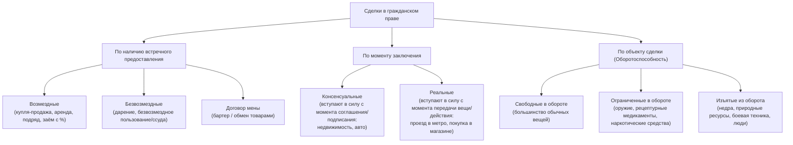
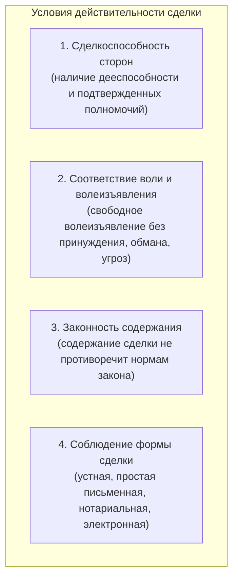
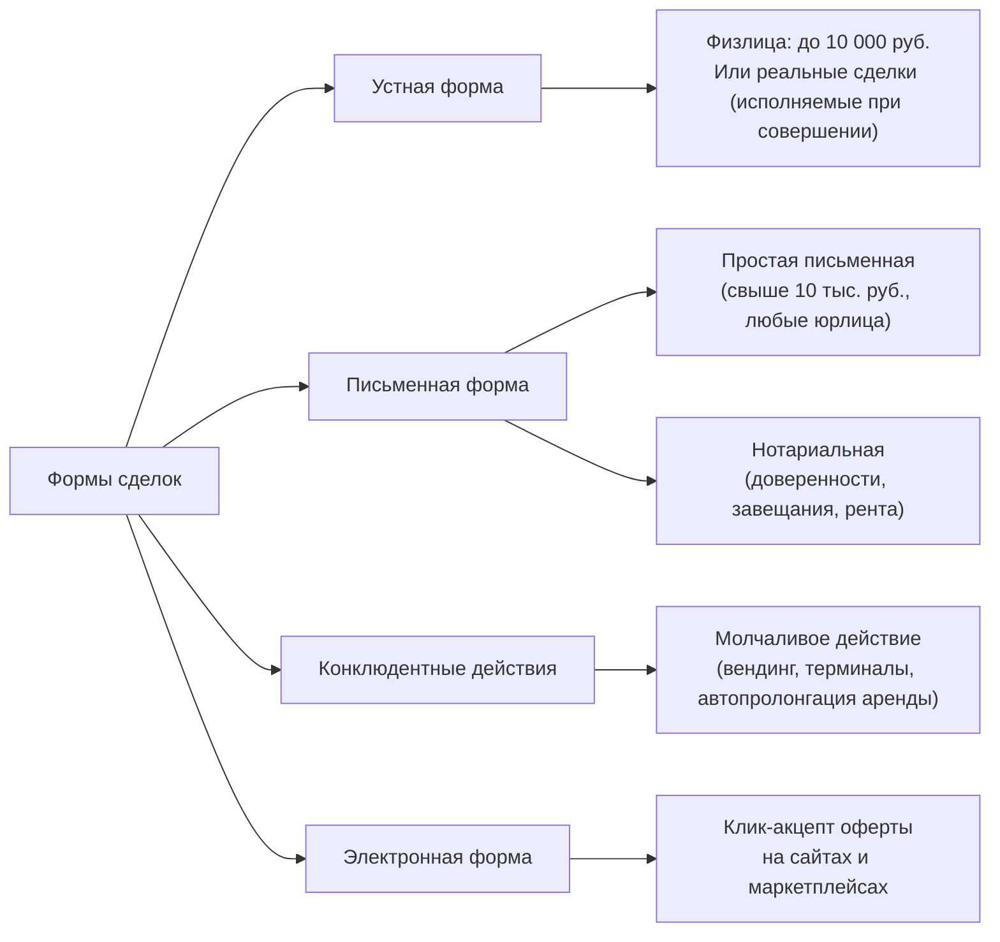
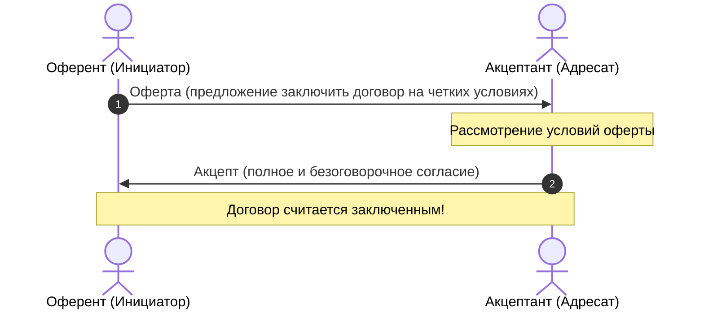
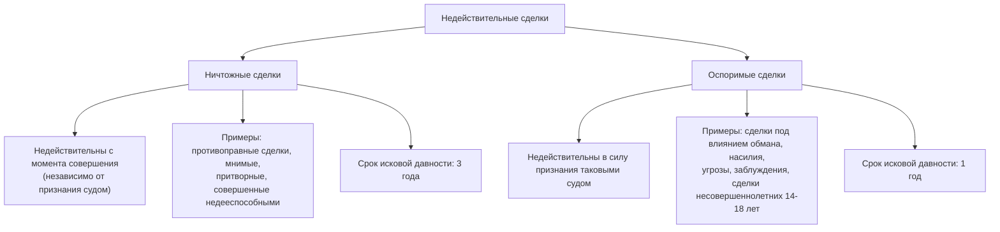
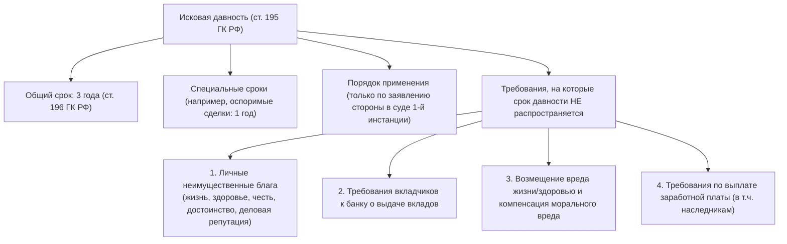
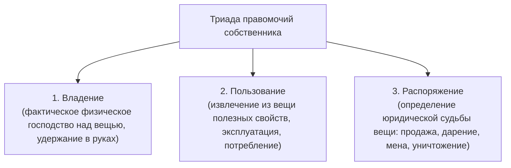
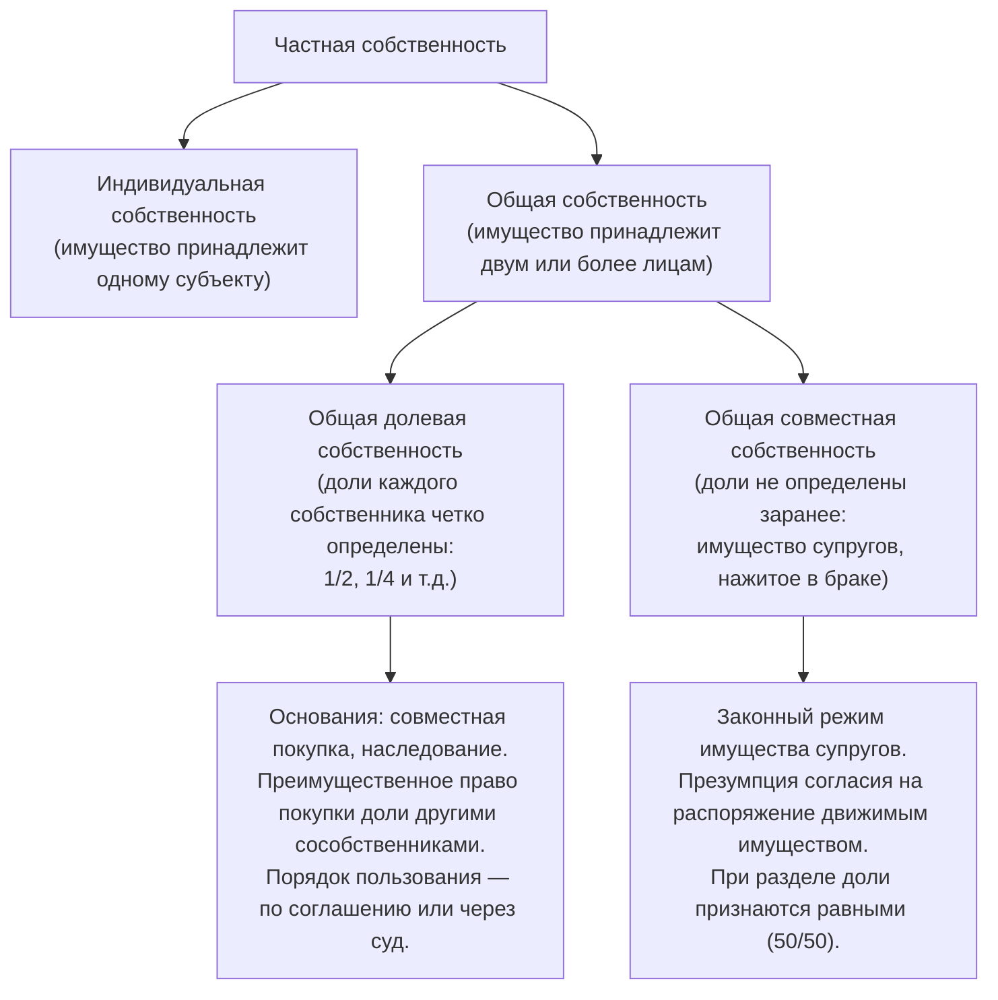

# Гражданское право РФ: Сделки, сроки и исковая давность, право собственности

> [!info] **Тема лекции**
> **Продолжение изучения гражданского права РФ: классификация сделок и условия их действительности, формы сделок, порядок исчисления сроков и институт исковой давности, а также основы вещного права (право собственности, триада правомочий и виды собственности).**

---

## 1. Классификация сделок и оборотоспособность объектов

Сделки в гражданском праве представляют собой волевые действия граждан и юридических лиц, направленные на установление, изменение или прекращение гражданских прав и обязанностей (ст. 153 ГК РФ).

---

### 1.1. Классификация по возмездности

1. **Возмездные сделки:**
   * Сделки, в которых сторона получает плату или иное встречное имущественное предоставление за исполнение своих обязанностей.
   * *Примеры:* договор купли-продажи (движимое/недвижимое имущество), возмездное оказание услуг (образовательные услуги, репетиторство), аренда (помещений, каршеринг), подряд, договор займа с процентами.
   * *Договор мены:* взаимная передача одного товара в обмен на другой без денежных расчетов (бартер). С юридической точки зрения является возмездным договором.

2. **Безвозмездные сделки:**
   * Сделки, по которым одна сторона обязуется предоставить что-либо другой стороне без получения от нее платы или встречного предоставления.
   * *Примеры:* договор дарения, договор безвозмездного пользования имуществом (ссуда).
   * *Наследование:* переход имущества в порядке универсального правопреемства (не является сделкой в традиционном смысле встречного договора, а представляет собой переход прав и обязанностей умершего лица).

> [!note] **Договор займа между гражданами**
> Если гражданин дает денежные средства в долг и прямо не указывает в договоре или расписке, что заём является беспроцентным, по закону займодавец имеет право потребовать уплаты процентов за пользование денежными средствами (ст. 809 ГК РФ).

---

### 1.2. Классификация по моменту заключения

1. **Консенсуальные сделки (от лат. *consensus* — соглашение):**
   * Считаются заключенными и вступают в силу **с момента достижения сторонами соглашения** по всем существенным условиям в требуемой законом форме (подписание договора).
   * Фактическая передача вещи и исполнение обязательств могут происходить значительно позже даты подписания договора.
   * *Пример:* договор купли-продажи квартиры. Договор вступает в силу с момента подписания, а передача ключей и фактическое вселение могут произойти через месяц или несколько месяцев. Расторжение или отказ от исполнения в одностороннем порядке недопустимы без компенсации убытков второй стороне.

2. **Реальные сделки (от лат. *res* — вещь):**
   * Для заключения сделки одного лишь соглашения недостаточно — требуется **фактическая передача вещи** или совершение конкретного действия.
   * Момент заключения совпадает с моментом фактического исполнения.
   * *Примеры:* 
     * Договор перевозки пассажира в метро или общественном транспорте — сделка считается совершенной в момент оплаты и прохода через турникет.
     * Розничная покупка товара в магазине самообслуживания.

---

### 1.3. Оборотоспособность объектов гражданских прав (ст. 129 ГК РФ)

1. **Объекты, находящиеся в свободном обороте:**
   * Могут свободно отчуждаться и переходить от одного лица к другому без каких-либо специальных разрешений. Составляют подавляющее большинство товаров и услуг.

2. **Объекты, ограниченные в обороте:**
   * Могут принадлежать лишь определенным участникам оборота либо приобретаться по специальному разрешению (лицензии).
   * *Оружие:* приобретение гражданского оружия строго регламентировано, требует лицензирования, проверок и соблюдения жестких правил хранения.
   * *Лекарственные средства и препараты:* сильнодействующие медикаменты, антибиотики, наркотические вещества для медицинских целей отпускаются строго по рецептам строгой отчетности.

3. **Объекты, изъятые из оборота:**
   * Объекты, отчуждение которых не допускается законом. Они не могут быть предметом гражданско-правовых сделок.
   * *Природные ресурсы и недра (нефть, газ в пластах):* принадлежат государству.
   * *Военная боевая техника, ядерное оружие, яды и токсичные химикаты.*
   * *Люди и органы человека:* продажа людей (рабство) и торговля органами категорически запрещены и влекут уголовную ответственность.
   * Сделки по поводу несуществующих или изъятых объектов (например, «продажа участка на Луне») являются **ничтожными**.

---

## 2. Условия действительности сделок

Для того чтобы сделка породила желаемые юридические последствия и не была признана недействительной, необходимо одновременное соблюдение **четырех базовых условий**.

---

### 2.1. Первое условие: Сделкоспособность сторон

* Стороны сделки должны обладать необходимой **гражданской дееспособностью** (ст. 21, 26, 28 ГК РФ).
* Если от имени стороны выступает представитель, его полномочия должны быть надлежащим образом подтверждены:
  * Законное представительство (родители за несовершеннолетних детей, опекуны за недееспособных);
  * Договорное представительство (доверенность, приказ о назначении генерального директора юридического лица).
* *Практический нюанс (презумпция согласия):* при передаче автомобиля в управление родственнику или знакомому доверенность сейчас не требуется, если водитель вписан в полис ОСАГО и имеет при себе СТС и водительское удостоверение — презюмируется согласие собственника. Однако штрафы с камер фиксации приходят собственнику ТС, и бремя доказывания невиновности лежит на нем.

---

### 2.2. Второе условие: Наличие и подлинность волеизъявления сторон

* Воля участника сделки должна формироваться свободно, без внешнего давления, насилия, угроз, обмана или существенного заблуждения.
* **Пороки воли:**
  * Если лицо совершило сделку под влиянием насилия или угрозы (ст. 179 ГК РФ), под воздействием мошенников или психологического давления, сделка может быть оспорена в судебном порядке.
  * *Сделка лица, не способного понимать значение своих действий (ст. 177 ГК РФ):* если дееспособный гражданин в момент совершения сделки находился в состоянии, когда он не мог осознавать свои действия (тяжелая болезнь, состояние аффекта, прием медикаментов), сделка может быть признана судом недействительной.
* *Способы минимизации рисков при сделках с недвижимостью:*
  * Получение справок из ПНД (психоневрологический диспансер) и НД (наркологический диспансер) — хотя справка подтверждает лишь отсутствие лица на учете, но не гарантирует вменяемость в конкретный момент.
  * Нотариальное удостоверение сделки — нотариус лично проверяет дееспособность сторон, фиксирует волеизъявление и несет имущественную ответственность.
  * Проверка продавца на банкротство — сделки, совершенные гражданином за 1–3 года до признания его банкротом, могут быть оспорены финансовым управляющим в интересах кредиторов.

---

### 2.3. Третье условие: Законность содержания сделки

* Условия и цели сделки не должны нарушать требования действующего законодательства, основ правопорядка и нравственности (ст. 168, 169 ГК РФ).
* Сделка с противоправным содержанием (продажа запрещенных веществ, торговля людьми, заказные правонарушения, фиктивные документы) является **ничтожной с момента ее совершения**.

---

### 2.4. Четвертое условие: Надлежащая форма сделки

Законодательство РФ предусматривает несколько допустимых форм совершения сделок:

1. **Устная форма (ст. 159 ГК РФ):**
   * Допустима по общему правилу для сделок **между физическими лицами на сумму не более 10 000 рублей**, а также для сделок, исполняемых при самом их совершении (розничная торговля).
   * Юридическим лицам совершать устные сделки запрещено.

2. **Письменная форма (ст. 160, 161 ГК РФ):**
   * *Простая письменная форма обязательна:*
     * Для всех сделок с участием юридических лиц (между собой или с гражданами);
     * Для сделок между гражданами на сумму, превышающую 10 000 рублей;
     * В случаях, прямо предусмотренных законом (независимо от суммы: договор аренды на срок от 1 года, договор страхования и др.).
   * *Нотариальная форма обязательна в случаях, указанных в законе (ст. 163 ГК РФ):*
     * Выдача генеральной доверенности на распоряжение имуществом;
     * Составление завещания;
     * Договор пожизненной ренты и пожизненного содержания с иждивением;
     * Сделки по отчуждению долей в праве общей собственности на недвижимое имущество;
     * Брачный договор.
   * *Государственная регистрация:* переход права собственности на недвижимое имущество подлежит обязательной регистрации в Росреестре (ст. 131 ГК РФ).

3. **Конклюдентные действия (ст. 158 ГК РФ):**
   * Совершение сделки путем поведения лица, из которого явствует его воля совершить сделку.
   * *Примеры:* покупка товара через автомат самообслуживания, оплата проезда валидатором.
   * *Молчание как волеизъявление:* по общему правилу **молчание не признается согласием** на совершение сделки, кроме случаев, установленных законом или обычаем. Исключение: если арендатор продолжает пользоваться имуществом после истечения срока договора при отсутствии возражений со стороны арендодателя, договор считается возобновленным на тех же условиях на неопределенный срок (автоматическая пролонгация аренды).

4. **Электронная форма:**
   * Заключение соглашений через электронные сервисы, интернет-магазины, клик по кнопке «Согласен с условиями оферты», использование простых и усиленных электронных цифровых подписей (ЭЦП).

---

## 3. Стадии заключения договора и недействительность сделок

### 3.1. Стадии заключения договора (ст. 432–438 ГК РФ)

1. **Оферта:**
   * Адресованное одному или нескольким конкретным лицам предложение, которое достаточно определенно выражает намерение лица считать себя заключившим договор с адресатом, принявшим предложение.
   * *Публичная оферта:* предложение, адресованное неопределенному кругу лиц, содержащее все существенные условия договора (ценники в магазинах, меню ресторанов, витрины интернет-магазинов). Продавец обязан продать товар по заявленной цене.

2. **Акцепт:**
   * Ответ лица, которому адресована оферта, о ее принятии.
   * Акцепт должен быть **полным и безоговорочным**. Молчание не является акцептом, если иное не вытекает из закона или соглашения сторон.

---

### 3.2. Виды недействительных сделок (ст. 166–181 ГК РФ)

---

## 4. Сроки в гражданском праве и исковая давность

> [!info] **Срок в гражданском праве**
> **$-$ это определенный период или момент времени, с наступлением или истечением которого нормы гражданского права связывают наступление определенных юридических последствий (возникновение, изменение или прекращение гражданских прав и обязанностей).**

---

### 4.1. Правила исчисления сроков (ст. 190–194 ГК РФ)

1. **Способы определения сроков:**
   * Календарной датой (например, «до 25 декабря 2026 года»);
   * Периодом времени: годами, кварталами, месяцами, неделями, днями, часами, минутами (каршеринг, поминутная тарификация);
   * Указанием на событие, которое должно неизбежно наступить;
   * Неопределенный срок (бессрочные договоры: например, бессрочный трудовой договор).

2. **Единицы измерения периодов по закону:**
   * **1 месяц** по закону принимается равным **30 календарным дням** (если исчисляется днями).
   * **Полмесяца** принимается равным **15 дням**.
   * **1 неделя** = **7 календарным дням**.

3. **Начало и окончание течения срока:**
   * *Начало течения срока:* по общему правилу начинается **на следующий день** после календарной даты или наступления события, которыми определено его начало (ст. 191 ГК РФ).
   * *Исключение:* реальные сделки (перевозка в метро, аренда каршеринга) вступают в силу немедленно в момент совершения действия.
   * *Окончание срока:*
     * Срок, исчисляемый годами, истекает в соответствующие месяц и число последнего года срока.
     * Срок, исчисляемый месяцами, истекает в соответствующее число последнего месяца срока. Если окончание срока приходится на месяц, в котором нет соответствующего числа (например, 29, 30 или 31 февраля), то срок истекает в **последний день этого месяца** (28 или 29 февраля).
     * Если последний день срока приходится на **нерабочий или праздничный день**, днем окончания срока считается **ближайший следующий за ним рабочий день** (ст. 193 ГК РФ).
     * Действие, для совершения которого установлен срок, может быть выполнено до 24:00 последнего дня срока. Но если действие должно быть совершено в организации (банк, суд, почта), срок истекает в час прекращения соответствующих операций.

---

### 4.2. Исковая давность (ст. 195–208 ГК РФ)

> [!info] **Исковая давность**
> **$-$ это установленный законом срок для защиты права по иску лица, право которого нарушено.**

* **Начало течения срока исковой давности (ст. 200 ГК РФ):**
  * Срок начинает течь со дня, когда лицо **узнало или должно было узнать** о нарушении своего права и о том, кто является надлежащим ответчиком.
* **Правило применения исковой давности судом:**
  * Истечение срока исковой давности не лишает гражданина права обратиться в суд с иском.
  * Суд обязан принять исковое заявление к рассмотрению.
  * **Исковая давность применяется судом исключительно по заявлению стороны в споре**, сделанному до вынесения судом решения первой инстанции.
  * Суд по своей инициативе применить исковую давность не имеет права! Если ответчик не заявил о пропуске срока, суд рассматривает дело по существу и удовлетворяет иск.
  * В апелляционной инстанции заявить об исковой давности уже нельзя, если заявление не подавалось в суде первой инстанции.
  * Истечение срока исковой давности, о применении которой заявлено стороной в споре, является самостоятельным основанием к вынесению судом решения об отказе в иске.

> [!warning] **Штрафы по Закону РФ «О защите прав потребителей»**
> При удовлетворении судом требований потребителя, которые не были удовлетворены продавцом/исполнителем добровольно, суд взыскивает с ответчика в пользу потребителя штраф в размере **50% от суммы, присужденной судом** (ст. 13 Закона о ЗПП).

---

## 5. Право собственности и вещные права

> [!info] **Право собственности**
> **$-$ это абсолютное вещное право, закрепляющее за собственником полное юридическое господство над индивидуально-определенной вещью в пределах, установленных законом, и позволяющее устранять от вмешательства в вещь всех третьих лиц.**

---

### 5.1. Триада правомочий собственника (ст. 209 ГК РФ)

Собственнику принадлежат три ключевых правомочия в отношении своего имущества:

1. **Право владения:**
   * Юридически обеспеченная возможность хозяйственного и фактического господства над вещью (нахождение вещи в помещении, в руках, в кармане).
   * Передача владения другому лицу (например, передача вещи на хранение, парковка) не лишает собственника его права собственности.

2. **Право пользования:**
   * Юридически обеспеченная возможность извлечения из вещи ее полезных свойств, плодов, продукции и доходов.
   * *Пример:* игра на рояле, просмотр телевизора, поездка на автомобиле. Передача вещи во временное пользование (аренда) также не прекращает права собственности.

3. **Право распоряжения (главное правомочие):**
   * Юридически обеспеченная возможность определять юридическую судьбу вещи: продать, подарить, обменять, передать в залог, уничтожить (если это не нарушает права третьих лиц и закон).
   * Потеря правомочия распоряжения означает утрату права собственности (например, при безотзывной выдаче полномочий на продажу).

---

### 5.2. Формы и виды собственности (ст. 8 Конституции РФ, ст. 212–259 ГК РФ)

Конституция Российской Федерации (ст. 8) признает и защищает равным образом следующие **формы собственности**:
1. Государственная собственность (федеральная и собственность субъектов РФ).
2. Муниципальная собственность (имущество городских и сельских поселений, муниципальных районов).
3. Частная собственность (граждан и юридических лиц).
4. Иные формы собственности.

---

### 5.3. Общая долевая и совместная собственность

#### 1. Общая долевая собственность:
* Доля каждого сособственника зафиксирована в праве собственности (например, 1/2, 1/3, 25%).
* **Основания возникновения:** совместная покупка имущества в складчину несколькими лицами, наследование квартиры несколькими наследниками по закону или завещанию.
* **Распоряжение долей (ст. 250 ГК РФ):**
  * При продаже доли постороннему лицу остальные участники долевой собственности имеют **преимущественное право покупки** продаваемой доли по цене и на прочих равных условиях.
  * Продавец обязан письменно известить остальных сособственников о намерении продать долю с указанием цены. Если остальные собственники откажутся или не приобретут долю в течение месяца (для недвижимости), продавец вправе продать ее третьему лицу.
  * Если долю предложили сособственникам за 3 млн руб., а третьему лицу продали за 2 млн руб., любой сособственник вправе через суд перевести на себя права и обязанности покупателя.
* **Порядок пользования жилым помещением:** сособственники определяют порядок пользования комнатами и местами общего пользования по соглашению, а при недостижении согласия — через суд.

#### 2. Общая совместная собственность (имущество супругов):
* Доли сособственников заранее не определены. Классический пример — имущество, нажитое супругами во время брака (ст. 34 Семейного кодекса РФ, ст. 256 ГК РФ).
* **Что является совместной собственностью:**
  * Доходы каждого из супругов от трудовой, предпринимательской, интеллектуальной деятельности;
  * Все движимое и недвижимое имущество, приобретенное за счет общих доходов во время брака (независимо от того, на чье имя оно оформлено или кем внесены деньги).
* **Что НЕ является совместной собственностью (раздельное имущество каждого супруга):**
  * Имущество, принадлежавшее каждому из супругов до вступления в брак;
  * Имущество, полученное во время брака в дар, в порядке наследования или по иным безвозмездным сделкам (приватизация);
  * Вещи индивидуального пользования (одежда, обувь), за исключением драгоценностей и предметов роскоши.
* **Особое правило при существенных вложениях (ст. 37 СК РФ):**
  * Имущество каждого из супругов может быть признано судом их совместной собственностью, если будет установлено, что в период брака за счет общего имущества или труда другого супруга были произведены вложения, значительно увеличившие стоимость этого имущества (капитальный ремонт, реконструкция, переоборудование квартиры).
* **Раздел имущества:**
  * При расторжении брака и разделе общего имущества доли супругов признаются **равными (50 на 50)**, если иное не предусмотрено брачным договором.
  * Брачный договор (заключается в письменной форме с обязательным нотариальным удостоверением) позволяет изменить законный режим совместной собственности и установить режим раздельной или долевой собственности на все или определенные виды имущества.

---

## Контрольные вопросы и выводы

1. **Какие четыре условия необходимы для признания сделки действительной?**
   * Сделкоспособность сторон; соответствие воли и волеизъявления; законность содержания сделки; соблюдение надлежащей формы.
2. **В чем отличие оспоримой сделки от ничтожной?**
   * Ничтожная сделка недействительна с момента заключения независимо от решения суда (срок давности — 3 года); оспоримая сделка недействительна лишь при признании ее таковой судом (срок давности — 1 год).
3. **Как исчисляется срок исковой давности и когда суд вправе его применить?**
   * Общий срок — 3 года со дня, когда лицо узнало или должно было узнать о нарушении своего права. Применяется судом исключительно по заявлению стороны в процессе до вынесения решения судом первой инстанции.
4. **На какие требования исковая давность не распространяется?**
   * На защиту нематериальных благ и личных неимущественных прав, требования вкладчиков к банку о выдаче вкладов, требования о возмещении вреда жизни и здоровью, требования по выплате невыплаченной заработной платы.
5. **Что входит в триаду правомочий собственника и какое правомочие является решающим?**
   * Владение, пользование и распоряжение. Решающим является правомочие распоряжения (определение юридической судьбы вещи).
